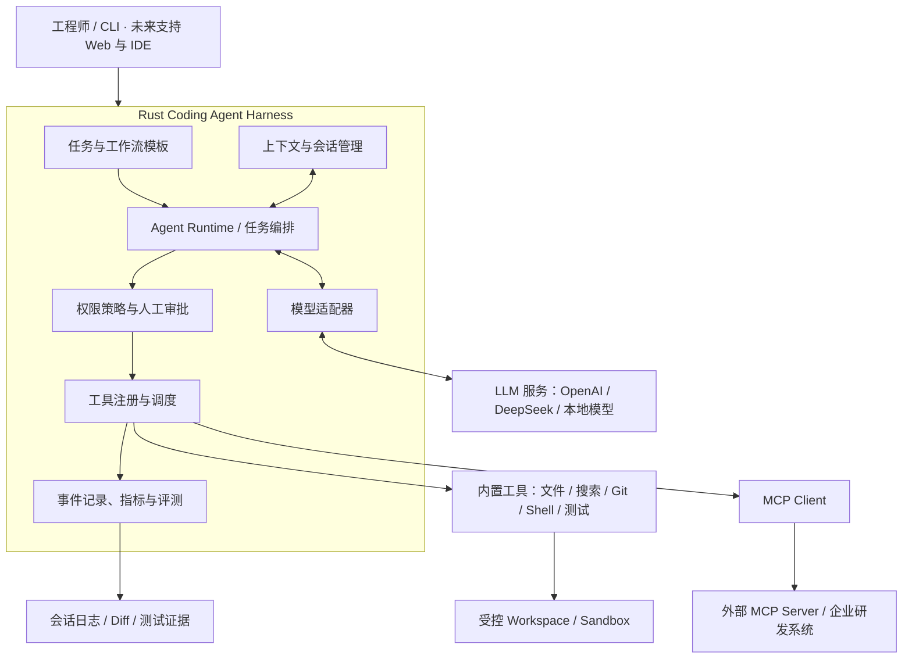
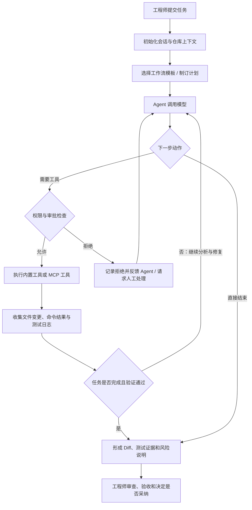

# Rust Coding Agent Harness

> 基于 Rust 的 AI 编程执行框架。参考 Codex 等成熟 Coding Agent 的公开设计，复用主流开源组件，逐步实现能够在真实代码仓库中规划任务、调用工具、修改代码、运行测试并交付可审查结果的 AI 编程系统。

**项目定位：**工程实践与技术学习优先，先复刻成熟能力，再依据真实使用和评测结果改进。AI 参与设计与编码，人类工程师负责关键决策、代码审查、测试验收和上线授权。

**项目状态：**架构规划阶段。本 README 描述目标方案与验收标准；所列能力不代表已经开发完成，实际进度以仓库代码、测试结果和运行记录为准。

## 1. 项目目标

本项目计划构建一个可扩展、可控制、可追踪的 Coding Agent Harness，使 AI 能够在指定代码仓库内完成常见的软件工程任务：

- **缺陷修复：**分析失败日志、定位问题、修改代码、运行回归测试。
- **功能开发：**理解需求、拆解工作、编写实现及相应测试。
- **代码重构：**分析影响范围，实施小步修改并验证兼容性。
- **代码评审：**结合 Git diff 和项目上下文识别风险，提交审查建议。
- **测试与诊断：**执行编译、单元测试、静态检查，收集证据并反馈。

项目不训练基础大模型，也不以重新实现现成的 HTTP、异步或模型 SDK 为目标。重点研究 **Harness 如何协调模型、工具、状态、权限和工程验证**。

## 2. 总体架构



架构职责按以下原则划分：

| 模块 | 主要职责 |
| --- | --- |
| Agent Runtime | 驱动模型与工具之间的多轮交互，维护任务状态及停止条件。 |
| 任务与工作流模板 | 为修 Bug、开发功能、代码评审等任务提供可复用执行流程。 |
| 上下文与会话管理 | 管理项目规则、相关代码、对话历史、上下文裁剪与恢复。 |
| 模型适配器 | 统一模型请求、流式响应、工具调用数据结构。 |
| 工具注册与调度 | 注册内置工具和 MCP 工具，校验参数并收集执行结果。 |
| 权限策略与人工审批 | 控制文件访问、命令执行、外部连接及高风险操作。 |
| 事件记录与评测 | 记录每一步操作、耗时、Token 消耗、错误及任务结果。 |

## 3. Coding Agent 任务执行流程



任务循环必须支持用户取消、超时、工具失败、预算耗尽和安全终止。模型提出操作意图，但**实际文件读写、命令执行以及权限判断由 Harness 控制**。

## 4. 核心能力规划

### 4.1 Agent 与多智能体协作

第一阶段优先让**单 Agent 执行循环**稳定运行；在此基础上逐步加入明确分工的多 Agent 机制：

| 角色 | 职责 |
| --- | --- |
| Planner | 理解目标、拆解任务、安排执行顺序。 |
| Coder | 阅读与修改代码，依据反馈持续修复。 |
| Tester | 运行测试、分析失败、提供验证结果。 |
| Reviewer | 审查 Diff、风险、工程规范和可维护性。 |
| Summary / Memory | 整理任务结论、重要上下文和可复用经验。 |

所有 Agent 共用 Harness 的工具权限、会话状态和执行记录；**多 Agent 不是默认并行执行所有任务**，而是根据任务复杂度按需启用。

### 4.2 内置工具与 MCP

内置工具按能力分组：

- **代码操作：**文件浏览、读取与修改、全文搜索、补丁应用、Git diff。
- **执行验证：**Shell、编译、测试、Lint、格式化、结果采集。
- **研发辅助：**文档查询、API 调试、日志诊断，后续扩展浏览器验证。

通过 MCP Client 对接符合协议的 MCP Server，按需接入代码托管、工单、文档知识库、CI/CD 和其他企业研发服务。**MCP 工具与内置工具适用同一套授权、审批、超时和审计机制**。

### 4.3 工作流模板

初期建设四类模板：

| 模板 | 标准流程 |
| --- | --- |
| Bug 修复 | 获取复现信息 → 定位原因 → 修改 → 测试 → 评审 → 交付 |
| 功能开发 | 理解需求 → 规划实现 → 编码 → 补充测试 → 验收 |
| 代码评审 | 读取 Diff → 分析上下文 → 检查风险 → 提交建议 |
| 重构 | 明确行为基线 → 分批修改 → 回归测试 → 对比结果 |

模板用于规范默认执行方式；具体动作仍由 Agent 结合实际仓库状态判断，不能只靠固定顺序机械执行。

## 5. 技术选型

| 类别 | 计划采用 | 说明 |
| --- | --- | --- |
| 核心开发语言 | **Rust** | Harness、工具编排与执行控制。 |
| LLM 生态 | **Rig（按需采用）** | 优先复用模型接入能力，保留替换空间。 |
| 异步运行时 | Tokio | 并发、异步 I/O、任务取消。 |
| HTTP / 序列化 | Reqwest / Serde | 模型 API、外部服务和数据结构。 |
| CLI / TUI | Clap / Ratatui（后续） | 命令行入口与终端交互。 |
| 代码检索 | ripgrep / ignore | 项目内容与文件检索。 |
| 代码分析 | Tree-sitter（后续） | 语法结构与代码导航。 |
| 数据存储 | JSONL，按需扩展 SQLite | 会话、执行事件和评测记录。 |
| 工具互联 | MCP | 扩展外部工具与研发系统。 |
| 进程与隔离 | Rust 进程管理 + 沙箱方案 | 命令超时、隔离与资源限制需独立验证。 |

选型以成熟生态、可维护性和可测试性为优先，避免在首版引入复杂的分布式编排。

## 6. 迭代路线

| 阶段 | 交付重点 | 验收目标 |
| --- | --- | --- |
| M1 · 最小运行 | Rust CLI、模型调用、单 Agent Loop、基础工具协议 | 模型能够连续调用工具并正确停止。 |
| M2 · 真实编码 | 文件与 Git 工具、Shell、补丁、测试 | 在隔离测试仓库内独立完成一次缺陷修复。 |
| M3 · 可靠性 | 审批、超时、状态保存、上下文管理、安全隔离 | 能处理中断、失败和越权请求，保留完整记录。 |
| M4 · 平台扩展 | 工作流模板、MCP、多 Agent | 完成至少一个跨角色、跨工具的编码任务。 |
| M5 · 实际使用与评测 | 固定任务集、使用记录、成本与成功率分析 | 用可复现实验评估质量，并持续改进。 |

上述为**计划里程碑**，不表示已完成或已承诺具体交付日期。

## 7. 人机协作与质量控制

本项目采用“AI 实现、人类负责”的协作方式：AI 可以阅读参考实现、编写代码、补充测试和修复问题；工程师负责架构选择、关键代码理解、风险评估、验收与合并。

每次可验收的变更应尽量包含：

1. 任务目标及影响范围。
2. 代码修改说明和可检查的 Git diff。
3. 实际执行的构建、测试命令及其结果。
4. 已知风险、未解决问题和后续处理建议。

重点模块包括 Agent Loop、工具执行、权限控制、上下文管理及会话恢复，应特别审查异常路径和边界条件。不得以“AI 声称测试通过”代替真实测试结果。

## 8. 安全边界

系统处理真实代码仓库和可执行命令，必须明确以下约束：

- 模型与 Agent 不直接获得无限制宿主机访问权：agent 发起的每个子进程都运行在**进程沙箱**内（Windows Job Object）——整树内存上限（单进程 4 GiB）、进程数上限（256）、超时或结束时**终止整个进程树**（含孙进程；`cmd /C "start /b ..."` 拉起的后代不再失控）。沙箱默认强制生效、不可关闭；创建或纳入失败时命令降级执行，但模型会在工具结果开头看到"进程沙箱未生效"的提示（该文本随 `ToolObserved` 进入审计证据），非 Windows 平台一律降级（Linux 版沙箱是后续工作）。
- 文件操作限制在指定 Workspace 内，防范路径越界。
- Shell、MCP 和外部连接遵循最小权限原则；高风险操作必须审批。
- MCP Server 连接与工具发现各有独立超时（握手+发现整体 30 秒、发现阶段 15 秒）："握手成功但对工具清单无响应"的半死 Server 会被收口成可读错误并降级为警告，不会挂死启动。
- 记录操作日志、退出码、文件变更和测试结果，便于追踪及回滚。
- 对超时、异常输出、取消和资源耗尽实施可控终止。
- **未经充分测试与授权，不允许自动执行生产环境发布、删除数据或其他高风险变更。**

沙箱的已知边界（决定"能不能上真实仓库"的判断）：Job Object 管不住**沙箱边界之外**的能力——命令仍可访问网络、读取用户文件（环境脱敏只清进程环境变量，不隔离文件系统），spawn 与纳入 Job 之间的微秒级窗口内拉起的孙进程不在树内（有意接受的取舍，未用 CREATE_SUSPENDED 收窄）。沙箱是"跑起来之后最多祸害多少"的机械边界，不是操作系统级的完全隔离；文件系统级隔离（AppContainer/受限令牌）是明确的非目标。

安全策略、实际沙箱强度和部署适用范围以实现和验证结果为准。

## 9. 项目资料

- [OpenAI Codex（Rust 实现参考）](https://github.com/openai/codex)
- [Rig（Rust LLM / Agent 生态）](https://rig.rs/)
- [Model Context Protocol](https://modelcontextprotocol.io/)

建议将项目架构展示页保存为 `docs/architecture.html`，与本 README 一同维护。当前 README 为技术方案说明，**实际安装命令、运行示例和目录结构将在首个可运行版本提交后补充**，避免提供尚不存在的操作步骤。

## 9.5 运行方式

### 环境变量

复制 `.env.example` 为 `.env` 并填入真实值（PowerShell：`Copy-Item .env.example .env`）：

| 变量 | 必需 | 说明 |
|------|------|------|
| `LLM_BASE_URL` | 是 | OpenAI 兼容服务地址，请求发往 `{LLM_BASE_URL}/chat/completions` |
| `LLM_API_KEY` | 是 | API Key |
| `LLM_MODEL` | 是 | 模型名称 |
| `LLM_MAX_TURNS` | 否 | ReAct 循环最大轮数，默认 20 |
| `QCH_POLICY` | 否 | 策略配置文件路径，缺省用内置默认策略 |
| `QCH_AUTO_APPROVE` | 否 | 设为 `1` 跳过人工审批，供 CI 使用 |
| `QCH_MAX_WALL_CLOCK` | 否 | 墙钟上限（秒）：编排模式下每步的会话各自计时（单步上限），`--resume` 时是本次恢复运行的上限；超时返回可区分的错误，不设置则不限时 |
| `QCH_SUMMARIZE_MIN_DROPPED` | 否 | 被裁历史累积到多少轮才花一次 LLM 调用生成摘要；不设置则只用占位说明 |
| `QCH_MCP_CONFIG` | 否 | MCP 配置文件路径（TOML），配置了才连接外部 MCP Server；缺省时 MCP 关闭 |

单次模型调用有 300 秒的硬时限（内置默认，暂不可配置）：连接挂死时中止该次调用并报可区分的错误，任务停在可恢复的断点，用 `--resume` 续跑即可。

### 上下文与预算

长任务的历史不会无限发给模型：`AgentRunner` 按**上下文预算**裁剪请求历史——默认保留最近 16 轮完整片段，更早的轮次整体省略，并在原位插入一条占位说明（指出省略范围与找回方式 `search_text` / `read_file`）；最初的用户任务始终保留。裁剪只改"发给模型时怎么看"，会话本身始终是全量真相，每次裁剪都会留下 `ContextCompacted` 证据事件（控制台同步播报 `[上下文]` 行）。

预算有三个维度，任一用尽即停，错误可区分：

| 维度 | 默认 | 用尽时 |
|------|------|--------|
| 轮数 | `LLM_MAX_TURNS`（20） | `BudgetExhausted`，提示调大轮数 |
| 墙钟 | 不限时（`QCH_MAX_WALL_CLOCK` 可设） | `WallClockExhausted`，带实际耗时与上限 |
| 取消 | 外部调用 `cancel_handle()` | `Cancelled`，历史完整保留 |

超时与取消都只在"准备问模型"之前生效：正在执行的工具轮次允许跑完，已花出去的 token 不废在半途。

### 会话恢复

运行中的每个保存点（每轮提交后、停在审批闸门前、任务完成、出错前）都会把完整可恢复状态原子写入 `.qcodeharness/snapshots/<会话ID>.json`（先写临时文件刷盘再改名，半途崩溃不会留下截断的快照）。快照带格式版本号，读到不认识的版本直接拒绝而不是猜着兼容；历史在重建时逐条校验配对不变量，损坏的快照变成显式错误。

**P5 起快照格式版本升为 2**（快照里多了每一步的角色信息）。P4 及更早产生的 1 号快照恢复时会被明确拒绝并报出版本差异，不做静默兼容——旧会话无法用 `--resume` 续跑，涉及旧会话的任务请重新执行。拒绝是刻意的：角色语义变了，拿旧快照猜着跑比直接说"不支持"危险。

```powershell
cargo run -- --list-sessions              # 列出可恢复的会话（ID、轮数、停在哪）
cargo run -- --resume <会话ID>            # 从断点继续，沿用快照里的原任务与系统提示词
```

恢复语义：半轮状态（工具执行到一半）恢复后从下一条调用继续，已跑完的观察不重跑；停在审批闸门的会话恢复后把同一个请求重新递给闸门；取消标记不跨恢复传递——恢复是一次新的"继续"意图。快照保存失败只打 stderr 警告，任务继续。恢复的运行接着计算墙钟预算（快照里的已耗时长是基数）。

### 任务编排

任务默认按**工作流模板**拆成有序步骤逐步执行，`--kind` 选择模板（默认 `bug-fix`）：

```powershell
cargo run -- "修复 greet 测试失败"                    # 默认走 bug-fix 模板
cargo run -- --kind review "评审最近的改动"
```

| 模板 | `--kind` | 步骤（角色） |
|------|----------|------|
| 修 Bug | `bug-fix` | 定位问题（Planner）→ 最小修改（Coder）→ 测试验证（Tester）→ 汇总与遗留风险（Coder） |
| 加功能 | `feature` | 理解需求（Planner）→ 规划实现（Planner）→ 编写实现（Coder）→ 验证实现（Tester） |
| 代码评审 | `review` | 读 diff → 理解上下文 → 识别风险 → 合并建议（四步全为 Reviewer） |
| 重构 | `refactor` | 行为基线（Tester）→ 分批改造（Coder）→ 回归测试（Tester）→ 对比总结（Reviewer） |

每步按**角色**装配：编排器从角色档案（`AgentProfile`）查出该角色的系统提示词与工具白名单，而不是四个步骤共用一个"全能 Agent"。只读分析角色（Planner / Reviewer）只拿 5 个只读工具，Tester 额外有 `run_command`，Coder 不限。约束因此是双重的：提示词明说"不许做"，工具列表里也根本没有对应能力——模型想改文件连调用入口都没有。档案里配置了未注册工具名的，装配时忽略并打警告。每步开始时证据里记一条 `StepStarted`（带角色），复盘时谁跑的每一步一目了然。

每步是**独立的 AgentRunner 与独立会话**（步骤历史不跨步传递——步骤边界才是自然的上下文压缩点），因此步骤说明必须自包含，模板里的 `{goal}` 会替换成实际任务目标。每步一份独立的证据 JSONL；结束汇总里列出各步骤的会话 ID，任一步都可以 `--resume` 单独续跑。任一步失败则任务标记失败并停止后续步骤。

### 历史摘要

默认的上下文裁剪用占位说明（"已省略第 X-Y 轮"）。设置 `QCH_SUMMARIZE_MIN_DROPPED` 后，被裁轮次累积到阈值且现有摘要没有覆盖时，会多花一次 LLM 调用把被裁片段压成摘要；摘要在其旧版本基础上增量合并，挂在会话上只生成一次（随快照持久化），后续请求直接复用——不是每轮重新生成。摘要覆盖了全部被裁轮次时替代占位说明，没覆盖全时保守退回占位说明。摘要调用失败自动降级为占位说明，任务不中断；成功留一条 `SummaryGenerated` 证据、失败留一条 `SummaryFailed` 证据，均计入轮数预算；连续失败达到 2 次后本次运行不再重试摘要。开启摘要后，实际模型调用数最多可能比 `LLM_MAX_TURNS` 多 1 次（该轮的摘要调用 + 正式调用）。

### 内置工具

| 工具 | 风险 | 用途 |
|------|------|------|
| `read_file` | 只读 | 读取 workspace 内文本文件；默认最多显示前 400 行（`max_lines` 可调，上限 2000），超长附总行数并提示用 `search_text` 定位 |
| `list_dir` | 只读 | 列出目录内容 |
| `search_text` | 只读 | 递归搜索子串，输出 `路径:行号:内容`；跳过 `.git`/`target`/`node_modules`/`.qcodeharness` |
| `git_status` | 只读 | `git status --porcelain`，空输出即工作区干净 |
| `git_diff` | 只读 | `git diff`（`staged: true` 时 `--staged`），输出截断到 4000 字符 |
| `write_file` | 破坏性 | 创建新文件或整体覆盖 |
| `edit_file` | 破坏性 | 查找替换式修改；`old_string` 必须在文件中恰好出现一次，否则拒绝执行 |
| `run_command` | 破坏性·开放世界 | 在 workspace 根下执行 shell 命令，运行在进程沙箱内（整树内存/进程数受限，超时终止全部后代进程）；沙箱未生效时结果开头会显式声明。超时默认 30s 上限 300s；疑似密钥的环境变量（名字含 key/token/secret/password/credential）不会传入子进程；输出超过 8000 字符截断 |

工具规格与执行入口绑定在同一个注册表里，`read_file` 与 `edit_file` 的分工写在各自描述中：新建或整体重写用 `write_file`，小段修改用 `edit_file`。

### 运行

```powershell
cargo run -- "阅读 Cargo.toml，说明本项目用了哪些依赖"
```

任务按模板编排执行（默认 `bug-fix`，见"任务编排"一节）：控制台先打印任务、模板与审批模式，然后每个步骤独立跑 ReAct 循环（轮次分隔线、`[思考]`、`[行动]`、`[观察]`），结束是 `──── 最终答案 ────` 与一行汇总（任务 ID、完成步数、各步骤会话 ID）。

### 缺陷修复演练（隔离仓库）

`tests/fixtures/broken-repo/` 是一个自带失败测试的小 crate（`greet` 忘了拼名字）。可以把它拷到任意目录，让 agent 真实修复它——这是观察 ReAct 循环 + 工具体系 + 审批闸门协同工作的最短路径：

```powershell
Copy-Item -Recurse tests/fixtures/broken-repo $env:TEMP\qch-demo
Copy-Item policy.example.toml $env:TEMP\qch-demo\policy.toml
$env:QCH_POLICY = "$env:TEMP\qch-demo\policy.toml"
cargo run --manifest-path <主项目路径>\Cargo.toml -- "修复 broken-repo 里失败的测试"
```

过程中的典型节奏：`read_file` 看代码（免审）→ `edit_file` 改一行（要审批）→ `run_command cargo test`（要审批）→ 输出 `test result: ok` 后给出最终答案。

### 审批

默认情况下，每个非只读工具执行前都会停下来问：

```
──── 审批请求 ────
工具:   write_file
参数:   {"path":"src/main.rs","content":"..."}
风险:   破坏性 · 非幂等
批准执行？[y] 允许  [n] 否决  [a] 本会话允许此工具  [q] 中止运行:
```

`y` 放行本次、`n` 否决并追问原因（原因会回填给模型）、`a` 在本会话内信任该工具、`q` 中止整个运行。

**fail-closed**：空输入、无法识别的输入、stdin 关闭（EOF）一律视为否决。终端没人看着的时候，工具不会被放过去。

`--yes` 参数或 `QCH_AUTO_APPROVE=1` 可退回全自动放行，供脚本和 CI 使用。

### 策略配置

`QCH_POLICY` 指向一份 TOML 文件，规则按数组顺序匹配，**第一条命中的生效**；都不命中则走默认策略（只读放行、非只读要审批）。想让某条 `Deny` 优先，就把它写在前面。

仓库根目录的 [`policy.example.toml`](policy.example.toml) 是一份完整可用的示例：五个只读工具免审，三个副作用工具逐次审批，并在注释里说明通配 deny 兜底的用法与代价。下面的片段演示方向性写法：

```toml
# policy.toml

[[rules]]
tool = "read_file"
verdict = "require_approval"
description = "读敏感目录要人工确认"

[[rules]]
tool = "write_file"
verdict = "allow"
description = "src/ 下的写入在信任范围内，免审"

# 通配规则（不写 tool 字段匹配所有工具）放在最后兜底
[[rules]]
verdict = "deny"
description = "其余工具一律禁止"
```

`verdict` 取值 `allow` / `require_approval` / `deny`，大小写不敏感。无法识别的值按 `require_approval` 处理——宁可多问一句，不能因为一个拼写错误放过高危工具。

### MCP 工具（外部 Server）

设置 `QCH_MCP_CONFIG` 指向一份 TOML 文件，即可把外部 MCP Server 的工具接进注册表（P5 仅支持 stdio 传输；未设置时 MCP 关闭）：

```toml
[[mcp_servers]]
name = "fetch"
command = "uvx"
args = ["mcp-server-fetch"]
```

接入规则：

- **命名**：MCP 工具以 `mcp__<server>__<tool>` 进注册表。前缀让来源在证据、审批请求与策略规则里肉眼可辨，也从根本上杜绝与内置工具（或别的 Server 的同名工具）撞名后被静默覆盖——某 Server 暴露了与 `read_file` 同名的工具时，两者并存。Server 名字只允许字母、数字、下划线与连字符，且不得重复，违者在加载时直接报错。
- **风险分级**：注解由 Harness 从工具名与描述**自行推断**，不信任 Server 自报的 `readOnlyHint`——那是对方的一面之词，据此放行等于把审批边界交给被接的一方。推断保守优先：名字与描述里"有读动词（read/get/list/search/…）且无写动词（write/create/delete/update/…）"才判只读免审，拿不准一律按可写处理、走审批闸门。MCP 工具的完整名可以直接写进策略规则（如 `tool = "mcp__fetch__get_page"`）。
- **降级**：单个 Server 连接失败（进程起不来、连接超时 30 秒）只打一条 stderr 警告并跳过，其余 Server 与全部内置工具照常可用；每次工具调用另有 120 秒超时，不会挂死整个步骤。
- **配置错误即停**：配置文件存在但解析失败、或 Server 定义非法时进程直接退出（与策略配置同一哲学）——用户明确想接的集成，不能静默丢掉让模型拿着残缺的工具清单跑任务。文件不存在则视为没配 MCP，正常关闭。

### 证据文件

每次运行的审计事件追加写入 `<workspace>/.qcodeharness/sessions/<session_id>.jsonl`，每行一条 JSON，含 `sequence`、`recorded_at`（秒级 Unix 时间戳）和 `event`。运行结束后可从汇总行直接拿到文件路径。

证据汇故障不会中断 ReAct 循环：单条写入失败时丢弃该条并在 stderr 打一条警告。

### 运行报表（--report）

```powershell
cargo run -- --report                        # 统计当前工作区
cargo run -- --report --report-dir <目录>    # 统计别的证据根目录
cargo run -- --report --json                 # 机器可读输出
```

报表从证据根目录的 `.qcodeharness/sessions/*.jsonl` 统计每个会话的事件数、模型调用次数、工具调用结局（成功/失败/拒绝）、审批分布、token 用量与成本合计。**不需要 API key**——报表只读证据文件，没配 `.env` 也能出。成本列的口径是诚实的：证据里没有成本数据（旧版本运行、或 provider 未报告）显示"未知"而不是 `$0.0000`；任一次调用成本未知，合计就是"未知"——被低估的合计比"未知"更危险。读取对坏行是宽容的：末尾被截断的 JSONL 行跳过并计入"坏行数"，不报错、不拖垮整个报表；但一个文件里没有一条能解析的行则显式报错，因为那多半是选错了文件，交回空数据会让报表看起来"一切正常"。

### 基准评测（--benchmark）

```powershell
cargo run -- --benchmark
```

跑 [`benchmarks/`](benchmarks/README.md) 下的固定任务集并打分：每个任务把自带的破损 fixture 仓库复制到临时目录，按工作流模板驱动 agent 修复，然后按**机器可判判据**打分——测试命令退出码、工作区有无实际改动、最终答案是否提到根因关键词。单任务失败不中断后续任务；结束打印 `通过 N/M 个任务`，有任务未通过时退出码为 1。

内置三个任务覆盖修 bug 的三类典型起点（编译错误 → 运行时 panic → 静默逻辑错误），难度梯度来自定位缺陷所需的推理量。任务的选取、判据写法与添加方法见 [benchmarks/README.md](benchmarks/README.md)。基准是可复现实验的地基：fixture 原件永不被动过，判据全部客观可查，同一任务集在不同模型或不同配置下的结果可以直接对比。

## 10. 预期成果

最终交付不仅是一款可运行的 AI 编程工具，还包括可读的 Rust 工程代码、架构设计、自动化测试、评测基线、故障处理记录和真实开发使用案例。项目价值将主要通过**代码任务完成情况、工程安全性和可复现证据**进行检验。
