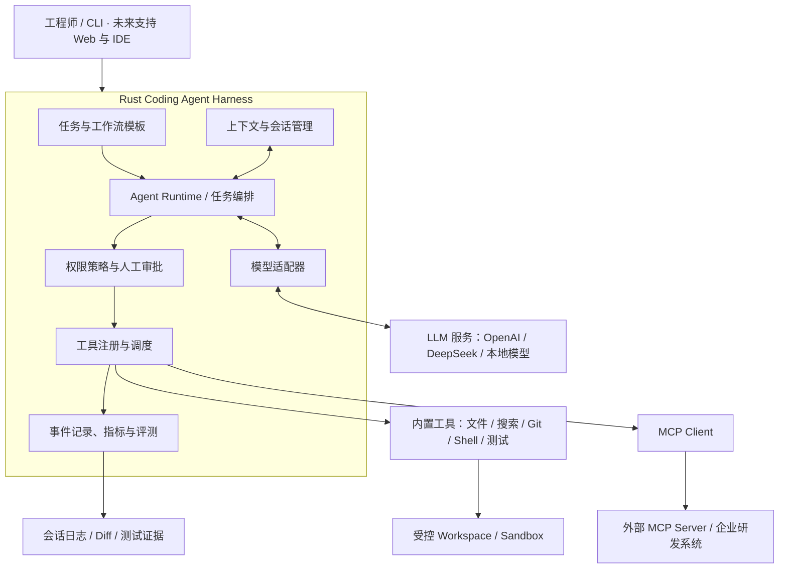
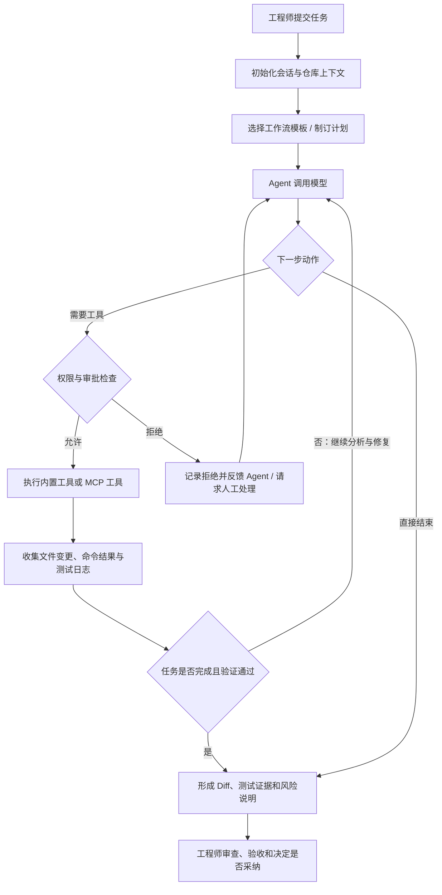

# Rust Coding Agent Harness

> 基于 Rust 的 AI 编程执行框架。参考 Codex 等成熟 Coding Agent 的公开设计，复用主流开源组件，逐步实现能够在真实代码仓库中规划任务、调用工具、修改代码、运行测试并交付可审查结果的 AI 编程系统。

**项目定位：**工程实践与技术学习优先，先复刻成熟能力，再依据真实使用和评测结果改进。AI 参与设计与编码，人类工程师负责关键决策、代码审查、测试验收和上线授权。

**项目状态：**架构规划阶段。本 README 描述目标方案与验收标准；所列能力不代表已经开发完成，实际进度以仓库代码、测试结果和运行记录为准。

## 1. 项目目标

本项目计划构建一个可扩展、可控制、可追踪的 Coding Agent Harness，使 AI 能够在指定代码仓库内完成常见的软件工程任务：

- **缺陷修复：**分析失败日志、定位问题、修改代码、运行回归测试。
- **功能开发：**理解需求、拆解工作、编写实现及相应测试。
- **代码重构：**分析影响范围，实施小步修改并验证兼容性。
- **代码评审：**结合 Git diff 和项目上下文识别风险，提交审查建议。
- **测试与诊断：**执行编译、单元测试、静态检查，收集证据并反馈。

项目不训练基础大模型，也不以重新实现现成的 HTTP、异步或模型 SDK 为目标。重点研究 **Harness 如何协调模型、工具、状态、权限和工程验证**。

## 2. 总体架构

架构职责按以下原则划分：

| 模块 | 主要职责 |
| --- | --- |
| Agent Runtime | 驱动模型与工具之间的多轮交互，维护任务状态及停止条件。 |
| 任务与工作流模板 | 为修 Bug、开发功能、代码评审等任务提供可复用执行流程。 |
| 上下文与会话管理 | 管理项目规则、相关代码、对话历史、上下文裁剪与恢复。 |
| 模型适配器 | 统一模型请求、流式响应、工具调用数据结构。 |
| 工具注册与调度 | 注册内置工具和 MCP 工具，校验参数并收集执行结果。 |
| 权限策略与人工审批 | 控制文件访问、命令执行、外部连接及高风险操作。 |
| 事件记录与评测 | 记录每一步操作、耗时、Token 消耗、错误及任务结果。 |

## 3. Coding Agent 任务执行流程

任务循环必须支持用户取消、超时、工具失败、预算耗尽和安全终止。模型提出操作意图，但**实际文件读写、命令执行以及权限判断由 Harness 控制**。

## 4. 核心能力规划

### 4.1 Agent 与多智能体协作

第一阶段优先让**单 Agent 执行循环**稳定运行；在此基础上逐步加入明确分工的多 Agent 机制：

| 角色 | 职责 |
| --- | --- |
| Planner | 理解目标、拆解任务、安排执行顺序。 |
| Coder | 阅读与修改代码，依据反馈持续修复。 |
| Tester | 运行测试、分析失败、提供验证结果。 |
| Reviewer | 审查 Diff、风险、工程规范和可维护性。 |
| Summary / Memory | 整理任务结论、重要上下文和可复用经验。 |

所有 Agent 共用 Harness 的工具权限、会话状态和执行记录；**多 Agent 不是默认并行执行所有任务**，而是根据任务复杂度按需启用。

### 4.2 内置工具与 MCP

内置工具按能力分组：

- **代码操作：**文件浏览、读取与修改、全文搜索、补丁应用、Git diff。
- **执行验证：**Shell、编译、测试、Lint、格式化、结果采集。
- **研发辅助：**文档查询、API 调试、日志诊断，后续扩展浏览器验证。

通过 MCP Client 对接符合协议的 MCP Server，按需接入代码托管、工单、文档知识库、CI/CD 和其他企业研发服务。**MCP 工具与内置工具适用同一套授权、审批、超时和审计机制**。

### 4.3 工作流模板

初期建设四类模板：

| 模板 | 标准流程 |
| --- | --- |
| Bug 修复 | 获取复现信息 → 定位原因 → 修改 → 测试 → 评审 → 交付 |
| 功能开发 | 理解需求 → 规划实现 → 编码 → 补充测试 → 验收 |
| 代码评审 | 读取 Diff → 分析上下文 → 检查风险 → 提交建议 |
| 重构 | 明确行为基线 → 分批修改 → 回归测试 → 对比结果 |

模板用于规范默认执行方式；具体动作仍由 Agent 结合实际仓库状态判断，不能只靠固定顺序机械执行。

## 5. 技术选型

| 类别 | 计划采用 | 说明 |
| --- | --- | --- |
| 核心开发语言 | **Rust** | Harness、工具编排与执行控制。 |
| LLM 生态 | **Rig（按需采用）** | 优先复用模型接入能力，保留替换空间。 |
| 异步运行时 | Tokio | 并发、异步 I/O、任务取消。 |
| HTTP / 序列化 | Reqwest / Serde | 模型 API、外部服务和数据结构。 |
| CLI / TUI | Clap / Ratatui（后续） | 命令行入口与终端交互。 |
| 代码检索 | ripgrep / ignore | 项目内容与文件检索。 |
| 代码分析 | Tree-sitter（后续） | 语法结构与代码导航。 |
| 数据存储 | JSONL，按需扩展 SQLite | 会话、执行事件和评测记录。 |
| 工具互联 | MCP | 扩展外部工具与研发系统。 |
| 进程与隔离 | Rust 进程管理 + 沙箱方案 | 命令超时、隔离与资源限制需独立验证。 |

选型以成熟生态、可维护性和可测试性为优先，避免在首版引入复杂的分布式编排。

## 6. 迭代路线

| 阶段 | 交付重点 | 验收目标 |
| --- | --- | --- |
| M1 · 最小运行 | Rust CLI、模型调用、单 Agent Loop、基础工具协议 | 模型能够连续调用工具并正确停止。 |
| M2 · 真实编码 | 文件与 Git 工具、Shell、补丁、测试 | 在隔离测试仓库内独立完成一次缺陷修复。 |
| M3 · 可靠性 | 审批、超时、状态保存、上下文管理、安全隔离 | 能处理中断、失败和越权请求，保留完整记录。 |
| M4 · 平台扩展 | 工作流模板、MCP、多 Agent | 完成至少一个跨角色、跨工具的编码任务。 |
| M5 · 实际使用与评测 | 固定任务集、使用记录、成本与成功率分析 | 用可复现实验评估质量，并持续改进。 |

上述为**计划里程碑**，不表示已完成或已承诺具体交付日期。

## 7. 人机协作与质量控制

本项目采用“AI 实现、人类负责”的协作方式：AI 可以阅读参考实现、编写代码、补充测试和修复问题；工程师负责架构选择、关键代码理解、风险评估、验收与合并。

每次可验收的变更应尽量包含：

1. 任务目标及影响范围。
2. 代码修改说明和可检查的 Git diff。
3. 实际执行的构建、测试命令及其结果。
4. 已知风险、未解决问题和后续处理建议。

重点模块包括 Agent Loop、工具执行、权限控制、上下文管理及会话恢复，应特别审查异常路径和边界条件。不得以“AI 声称测试通过”代替真实测试结果。

## 8. 安全边界

系统处理真实代码仓库和可执行命令，必须明确以下约束：

- 模型与 Agent 不直接获得无限制宿主机访问权。
- 文件操作限制在指定 Workspace 内，防范路径越界。
- Shell、MCP 和外部连接遵循最小权限原则；高风险操作必须审批。
- 记录操作日志、退出码、文件变更和测试结果，便于追踪及回滚。
- 对超时、异常输出、取消和资源耗尽实施可控终止。
- **未经充分测试与授权，不允许自动执行生产环境发布、删除数据或其他高风险变更。**

安全策略、实际沙箱强度和部署适用范围以实现和验证结果为准。

## 9. 项目资料

- [OpenAI Codex（Rust 实现参考）](https://github.com/openai/codex)
- [Rig（Rust LLM / Agent 生态）](https://rig.rs/)
- [Model Context Protocol](https://modelcontextprotocol.io/)

建议将项目架构展示页保存为 `docs/architecture.html`，与本 README 一同维护。当前 README 为技术方案说明，**实际安装命令、运行示例和目录结构将在首个可运行版本提交后补充**，避免提供尚不存在的操作步骤。

## 10. 预期成果

最终交付不仅是一款可运行的 AI 编程工具，还包括可读的 Rust 工程代码、架构设计、自动化测试、评测基线、故障处理记录和真实开发使用案例。项目价值将主要通过**代码任务完成情况、工程安全性和可复现证据**进行检验。
