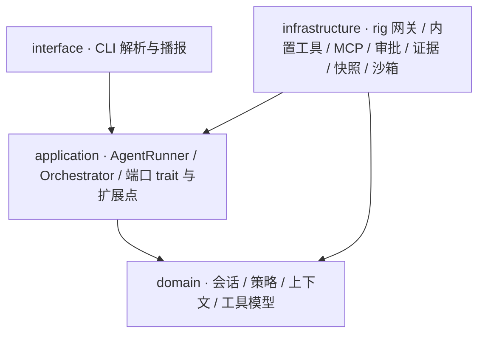

# 架构与扩展点

本文写两件事：代码分层怎么划，"想加一种新行为"该落在哪个扩展点。
产品能力与运行方式见 [README](../README.md)。

## 分层



依赖方向只有两条：`interface → application → domain` 与
`infrastructure → application/domain`。`domain/` 是纯领域层，**禁止**任何
IO、`rig`、`toml`、`tokio`、`windows` 与文件操作，这条边界由验收 grep 守着。
`application/` 的新增代码只依赖 domain 与端口 trait；需要读文件系统或起进程
的逻辑放 `infrastructure/`。

生产代码遵守这条边界：`application/` 不引用具体实现，需要文件、进程或
网络的模块放在 `infrastructure/`。单元测试可以用临时目录与 mock 网关，
那是测试装配，不算越层。

## 扩展点

核心循环只认端口 trait，不认具体供应商与工具来源。想加新行为时，按下表
找落点，不要先改 `agent_run.rs`。

| 想加的行为 | 扩展点（trait） | trait 位置 | 装配位置 | 默认实现 |
| --- | --- | --- | --- | --- |
| 接入另一家模型服务（地址、凭据、默认模型） | `LlmProvider` | `application/port/mod.rs` | `main.rs` 的 `ProviderRegistry`；首个登记项为默认 | `OpenAiCompatProvider`（`infrastructure/model/openai_compat.rs`） |
| 换掉一次模型调用的传输实现 | `ModelGateway` | `application/port/mod.rs` | `LlmProvider::gateway()` 交出 | `RigChatGateway`（`infrastructure/model/rig_chat.rs`） |
| 从别处提供一批工具（第三方工具包、远端目录） | `ToolSource` | `application/tool_registry.rs` | `ToolRegistry::from_sources`；`main.rs` 组装来源列表，同名工具后到的来源胜出 | `BuiltinToolSource`、`McpToolSource` |
| 在工具执行前拦截、拒绝或升级审批 | `ToolGuard` | `application/tool_guard.rs` | `AgentDependencies::additional_guards`（追加到内置链后；内置链由 `default_guard_chain` 构造），按链序合并、最严格者胜 | `PolicyGuard` + `BoundaryEscalationGuard` |
| 改发给模型的历史视图 | `ContextPolicy` | `application/context_policy.rs` | `AgentDependencies::context_policy` | `DefaultContextPolicy`（预算裁剪） |
| 观察运行事件（遥测、结构化事件流） | `RunHooks` | `application/port/mod.rs` | `AgentDependencies::hooks` | `NoopHooks` |
| 换审批方式 | `ApprovalGate` | `application/port/mod.rs` | `AgentDependencies::approvals` | CLI 交互闸门 / 自动放行 / AI 审查 |
| 换证据落点 | `EvidenceSink` | `application/port/mod.rs` | `AgentDependencies::evidence` | JSONL 文件 / 内存汇 |
| 给工具动作加时限 | `TimeLimiter` | `application/port/mod.rs` | `ExtensionRegistry::adapters` 的 `limiter` 参数 | `TokioTimeLimiter`（`infrastructure/clock.rs`） |
| 加一条声明式能力（提示词 + 事件触发的工具动作） | `Skill` / `Hook` / `Plugin` | `application/extension.rs` | `ExtensionRegistry`（`LocalExtensionStore` 从 `.qcodeharness/extensions/manifests/` 加载），`adapters()` 装配进任务 | 本地 TOML 清单；编译期 Plugin 示例见 `examples/custom-extension.rs` |
| 换一种隔离工作区 | `WorkspaceIsolation` + `WorkspaceVerifier` | `application/isolation.rs` | `SubAgentToolSource::new` 的 `isolation` / `verifier` 参数 | `GitWorktreeManager`（`infrastructure/git_worktree.rs`）+ `StructuralVerifier` / `CommandVerifier` |
| 换子 Agent 的依赖装配方式 | `ChildAgentFactory` | `application/delegation.rs` | `SubAgentToolSource::new` 的 `factory` 参数 | `ChildFactory`（`main.rs`，按子工作区重建工具、审批、证据与指令） |

两条可运行示例：

```powershell
cargo run --example custom-llm-provider   # 自定义 LlmProvider + 网关
cargo run --example custom-tool-source    # 自定义 ToolSource 与内置来源合并
cargo run --example custom-extension      # 编译期 Plugin：Skill + Hook
```

加新行为的判断顺序：

1. 能否实现现有 trait 并在装配层接线？能，就不改循环。
2. 需要新的扩展点？trait 放 `src/application/`，实现放 `src/infrastructure/`，
   默认实现与 trait 同模块或同层，装配位置写进上表。
3. 只有确实要改状态机本身（新的运行状态、新的停点）才动
   `application/agent_run.rs`，并且必须补行为测试。

## 配置与指令的来源

配置分四层合并：内置默认 → 用户级（`dirs::config_dir()/qcodeharness/config.toml`）
→ 项目级（`<workspace>/.qcodeharness/config.toml`）→ `QCH_CONFIG` 指定的文件。
相对路径按定义该字段的文件所在目录解析；列表整体替换，显式空列表会清空
继承值。环境变量仍在文件之后覆盖（`LLM_BASE_URL`、`LLM_MODEL`、`QCH_POLICY`、
`QCH_MCP_CONFIG`、运行预算），API Key 只从环境变量读。

项目级文件随仓库分发，因此**不能**设置 `llm.base_url`、`policy_path`、
`mcp_config_path`：这三项分别决定数据发往哪里、审批是否生效、启动时拉起
哪个子进程。写在项目级配置里会直接报错并指向对应的环境变量。

分层指令按 用户级 → workspace 根 → 更接近任务目录 的顺序拼接，每个文件
8 KiB、合计 32 KiB；目录链接越出 workspace 会被拒绝，同一物理文件经不同
词法路径出现时只保留优先级最高的一份。

扩展授权与扩展清单分开放：清单在仓库内的 `.qcodeharness/extensions/manifests/`，
授权状态在用户配置目录的 `qcodeharness/extension-state/<工作区哈希>.toml`。
克隆一个仓库不会带来"已批准"的权限。

## 明确不做

- **不做 cdylib/dylib 动态插件装载。** Rust 没有稳定 ABI，跨编译器传递 trait
  对象不安全；"社区扩展"的方式是依赖本 crate 编译，再在装配层接线。
- **不做通用脚本插件协议。** 已有的 manifest 只描述提示词与已声明的工具
  动作，不解释脚本、不加载动态库；权限以实际工具名精确匹配，由用户显式
  批准，新增清单默认禁用。需要任意逻辑的扩展仍按上面的扩展点写 Rust。
- **不提供多前端协议。** 结构化事件流、SDK/ACP、IDE 接入留给后续阶段；
  当前唯一前端是 CLI。扩展点先稳定，协议后行。
