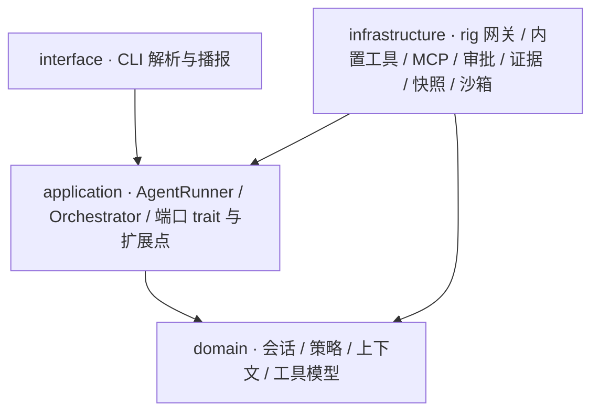

# 架构与扩展点

本文写两件事：代码分层怎么划，"想加一种新行为"该落在哪个扩展点。
产品能力与运行方式见 [README](../README.md)。

## 分层



依赖方向只有两条：`interface → application → domain` 与
`infrastructure → application/domain`。`domain/` 是纯领域层，**禁止**任何
IO、`rig`、`toml`、`tokio`、`windows` 与文件操作；需要读文件系统或起进程
的逻辑只能留在 `infrastructure/`。这条边界由验收 grep 守着。

## 扩展点

核心循环只认端口 trait，不认具体供应商与工具来源。想加新行为时，按下表
找落点，不要先改 `agent_run.rs`。

| 想加的行为 | 扩展点（trait） | trait 位置 | 装配位置 | 默认实现 |
| --- | --- | --- | --- | --- |
| 接入另一家模型服务（地址、凭据、默认模型） | `LlmProvider` | `application/port/mod.rs` | `main.rs` 的 `ProviderRegistry`；首个登记项为默认 | `OpenAiCompatProvider`（`infrastructure/model/openai_compat.rs`） |
| 换掉一次模型调用的传输实现 | `ModelGateway` | `application/port/mod.rs` | `LlmProvider::gateway()` 交出 | `RigChatGateway`（`infrastructure/model/rig_chat.rs`） |
| 从别处提供一批工具（第三方工具包、远端目录） | `ToolSource` | `application/tool_registry.rs` | `ToolRegistry::from_sources`；`main.rs` 组装来源列表，同名工具后到的来源胜出 | `BuiltinToolSource`、`McpToolSource` |
| 在工具执行前拦截、拒绝或升级审批 | `ToolGuard` | `application/tool_guard.rs` | `default_guard_chain()`（`application/agent_run.rs`），按链序合并、最严格者胜 | `PolicyGuard` + `BoundaryEscalationGuard` |
| 改发给模型的历史视图 | `ContextPolicy` | `application/context_policy.rs` | `AgentDependencies::context_policy` | `DefaultContextPolicy`（预算裁剪） |
| 观察运行事件（遥测、结构化事件流） | `RunHooks` | `application/port/mod.rs` | `AgentDependencies::hooks` | `NoopHooks` |
| 换审批方式 | `ApprovalGate` | `application/port/mod.rs` | `AgentDependencies::approvals` | CLI 交互闸门 / 自动放行 / AI 审查 |
| 换证据落点 | `EvidenceSink` | `application/port/mod.rs` | `AgentDependencies::evidence` | JSONL 文件 / 内存汇 |

两条可运行示例：

```powershell
cargo run --example custom-llm-provider   # 自定义 LlmProvider + 网关
cargo run --example custom-tool-source    # 自定义 ToolSource 与内置来源合并
```

加新行为的判断顺序：

1. 能否实现现有 trait 并在装配层接线？能，就不改循环。
2. 需要新的扩展点？trait 放 `src/application/`，实现放 `src/infrastructure/`，
   默认实现与 trait 同模块或同层，装配位置写进上表。
3. 只有确实要改状态机本身（新的运行状态、新的停点）才动
   `application/agent_run.rs`，并且必须补行为测试。

## 明确不做

- **不做 cdylib/dylib 动态插件装载。** Rust 没有稳定 ABI，跨编译器传递 trait
  对象不安全；"社区扩展"的方式是依赖本 crate 编译，再在装配层接线。
- **不定义通用插件协议。** 没有统一的 manifest、生命周期或权限声明语言；
  每个扩展点一个 trait，能力边界由 Rust 类型表达。将来若需要，另立设计。
- **不提供多前端协议。** 结构化事件流、SDK/ACP、IDE 接入留给后续阶段；
  当前唯一前端是 CLI。扩展点先稳定，协议后行。
